TRƯỜNG ĐẠI HỌC CÔNG NGHỆ THÔNG TIN VÀ TRUYỀN THÔNG

KHOA CÔNG NGHỆ THÔNG TIN

BÁO CÁO

MÔN:Ứng Dụng Trí Tuệ Nhân Tạo

ĐỀ TÀI: Hệ thống quản lý trang trại rau sạch có tích hợp AI

| SINH VIÊN THỰC HIỆN:  Cấn Văn Thái   : CNTTK23C Mã sinh viên         :DTC245200867  Hoàng Anh Tú            : CNTTK23C Mã sinh viên         :DTC245200321 | GIẢNG VIÊN HƯỚNG DẪN: Nguyễn Tuấn Anh |
| --- | --- |

Bảng Phân Công Nhiệm Vụ

|  | Công việc | Thành viên thực hiện | Ghi chú |
| --- | --- | --- | --- |
| Tuần 01 (Từ:  27/07/2026 Đến:  02/08/2026) | * Phân tích bối cảnh bài toán, quy trình nghiệp vụ & YC phi chức năng | Cấn Văn Thái | Thu thập đủ dữ liệu mẫu cho lô trồng, nhật ký. |
| Tuần 01 (Từ:  27/07/2026 Đến:  02/08/2026) | * Liệt kê YC chức năng (Input/Output) & Xác định các điểm tích hợp AI | Hoàng Anh Tú | Thu thập đủ dữ liệu mẫu cho lô trồng, nhật ký. |
| Tuần 02 (Từ:  03/08/2026 Đến:  09/08/2026) | Thiết kế Kiến trúc hệ thống (Frontend, Backend, DB, AI Service) | Cấn Văn Thái | Thống nhất sơ đồ Use Case và Kiến trúc hệ thống. |
| Tuần 02 (Từ:  03/08/2026 Đến:  09/08/2026) | Thiết kế Actor, Use Case, vẽ sơ đồ Use Case & kịch bản chi tiết | Hoàng Anh Tú | Thống nhất sơ đồ Use Case và Kiến trúc hệ thống. |
| Tuần 03 (Từ:  10/08/2026 Đến:  16/08/2026) | * Thiết kế CSDL (ERD, bảng dữ liệu, ràng buộc quan hệ) * Xây dựng cấu trúc System Prompt, User Prompt mẫu sơ bộ | Cấn Văn Thái | Hoàn thiện tài liệu SRS (Software Requirement Specification). |
| Tuần 03 (Từ:  10/08/2026 Đến:  16/08/2026) | * Chuẩn hóa file dữ liệu mẫu cho CSDL. Tổng hợp Nhật ký Prompting (Prompt Log) dùng AI trong thiết kế | Hoàng Anh Tú | Hoàn thiện tài liệu SRS (Software Requirement Specification). |
| Tuần 04 (Từ:  17/08/2026 Đến:  23/08/2026) | * Tổng hợp & Review Tài liệu phân tích thiết kế * Báo cáo phần Kiến trúc hệ thống, CSDL & Luồng AI. | Cấn Văn Thái | BÁO CÁO BÀI KIỂM TRA THƯỜNG XUYÊN 1 |
| Tuần 04 (Từ:  17/08/2026 Đến:  23/08/2026) | * Báo cáo phần Yêu cầu chức năng & Sơ đồ Use Case. | Hoàng Anh Tú | BÁO CÁO BÀI KIỂM TRA THƯỜNG XUYÊN 1 |
| Tuần 05 (Từ:  24/08/2026 Đến:  30/08/2026) | * Dựng cấu trúc dự án Django chuẩn * Viết API Đăng nhập, Xác thực JWT & Phân quyền RBAC (Quản lý, Kỹ thuật viên, Nhân viên) | Cấn Văn Thái | Đã đăng nhập phân quyền & chạy thành công CRUD 1. |
| Tuần 05 (Từ:  24/08/2026 Đến:  30/08/2026) | Khởi tạo dự án Frontend (React/Vite + Tailwind CSS) * Viết UI & Tích hợp API CRUD Lô đất, Giống cây | Hoàng Anh Tú | Đã đăng nhập phân quyền & chạy thành công CRUD 1. |
| Tuần 06 (Từ:  31/08/2026 Đến:  06/09/2026) | * Viết API CRUD Nhật ký, Vật tư, Thu hoạch & API Thống kê sản lượng Bẫy lỗi try-catch backend & Xử lý truy vấn CSDL | Cấn Văn Thái | BÁO CÁO BÀI KIỂM TRA THƯỜNG XUYÊN 2 |
| Tuần 06 (Từ:  31/08/2026 Đến:  06/09/2026) | * Viết UI Nhật ký chăm sóc, Vật tư, Thu hoạch & Bộ lọc/Tìm kiếm * Viết README.md, .env.example & Nhật ký AI coding | Hoàng Anh Tú | BÁO CÁO BÀI KIỂM TRA THƯỜNG XUYÊN 2 |
| Tuần 07 (Từ:  07/09/2026 Đến:  13/09/2026) | * Xây dựng AIService gọi Gemini API, bảo vệ API Key trong .env * Tách Prompt ra file riêng (.yaml/.py), thực hiện 3 vòng thử nghiệm tối ưu Prompt | Cấn Văn Thái | Chức năng AI chạy mượt mà ngay trên giao diện Local. |
| Tuần 07 (Từ:  07/09/2026 Đến:  13/09/2026) | * Truy vấn CSDL đẩy dữ liệu động vào Prompt (crop_lot, care_logs) * Làm UI hiển thị kết quả AI kèm Cảnh báo "Chỉ mang tính tham khảo" | Hoàng Anh Tú | Chức năng AI chạy mượt mà ngay trên giao diện Local. |
| Tuần 08 (Từ:  14/09/2026 Đến:  20/09/2026) | * Xử lý ngoại lệ AI: Timeout, Rate limit, lỗi mode * Sử dụng AI Review code, refactor và tối ưu chất lượng mã nguồn | Cấn Văn Thái | Hệ thống chạy ổn định, không bị crash khi AI ngắt kết nối. |
| Tuần 08 (Từ:  14/09/2026 Đến:  20/09/2026) | * Xây dựng bảng Test case (Trường hợp đúng, sai, biên) cho CRUD và AI * Kiểm thử thủ công (Manual test) toàn bộ hệ thống trên local. | Hoàng Anh Tú | Hệ thống chạy ổn định, không bị crash khi AI ngắt kết nối. |
| Tuần 09 (Từ:  21/09/2026 Đến:  27/09/2026) | * Tổng duyệt Source Code, CSDL Local demo & hỗ trợ kỹ thuật khi báo cáo. | Cấn Văn Thái | BÁO CÁO KT3 &  DỰ ÁN CUỐI KỲ |
| Tuần 09 (Từ:  21/09/2026 Đến:  27/09/2026) | * Complete Slide thuyết trình, Báo cáo tổng kết & Kịch bản phân công thao tác Demo Local. | Hoàng Anh Tú | BÁO CÁO KT3 &  DỰ ÁN CUỐI KỲ |

# LỜI CẢM ƠN

Em xin bày tỏ lòng biết ơn sâu sắc tới TS. Nguyễn Tuấn Anh — giảng viên học phần Ứng dụng trí tuệ nhân tạo — đã tận tình hướng dẫn, đóng góp ý kiến quý báu trong suốt quá trình thực hiện dự án.

Em xin cảm ơn Trường Đại học Công nghệ Thông tin và Truyền thông — Đại học Thái Nguyên đã tạo điều kiện học tập, cung cấp tài liệu và môi trường thực hiện dự án.

Em xin cảm ơn bạn bè, đồng nghiệp đã chia sẻ, hỗ trợ trong quá trình tìm hiểu công nghệ và hoàn thiện sản phẩm. Mặc dù đã cố gắng hoàn thiện, báo cáo không thể tránh khỏi thiếu sót. Em rất mong nhận được sự góp ý của thầy/cô và các bạn.

# DANH MỤC HÌNH

| STT | Tên hình | Vị trí |
| --- | --- | --- |
| Hình 3.1 | Sơ đồ Use Case tổng quát | 3.2 |
| Hình 3.2 | Phân rã Use Case — Quản lý | 3.3.1 |
| Hình 3.3 | Phân rã Use Case — Nhân viên | 3.3.2 |
| Hình 3.4 | Phân rã Use Case — Kỹ thuật viên | 3.3.3 |
| Hình 3.5 | Activity Diagram | 3.4 |
| Hình 3.6 | Sequence — Ghi nhật ký | 3.5.1 |
| Hình 3.7 | Sequence — AI tóm tắt (RAG) | 3.5.2 |
| Hình 4.1 | Sơ đồ ERD | 4.2 |
| Hình 5.1 | Kiến trúc tổng thể | 5.1 |
| Hình 5.2 | Design Class Diagram | 5.3 |
| Hình 5.3 | Deployment Diagram | 5.8 |
| Hình 5.4 | Cấu trúc dự án | 5.13 |
| Hình 5.5 | Màn hình AI & cảnh báo | 5.17 |
| Hình 7.1→7.6 | Ảnh demo hệ thống | Chương 7 |

# DANH MỤC BẢNG

| STT | Tên bảng | Vị trí |
| --- | --- | --- |
| Bảng 2.1 | Yêu cầu chức năng | 2.5 |
| Bảng 2.2 | Yêu cầu phi chức năng | 2.6 |
| Bảng 2.3 | Quy tắc nghiệp vụ BR01→BR08 | 2.7 |
| Bảng 2.4 | Đặc tả Use Case chi tiết | 2.9 |
| Bảng 3.1 | Đặc tả Use Case theo tác nhân | 3.3 |
| Bảng 4.1 | Danh sách 11 bảng dữ liệu | 4.3 |
| Bảng 4.2 | Data Dictionary | 4.5 |
| Bảng 5.1 | API endpoints (32) | 5.5 |
| Bảng 5.2 | Lựa chọn công nghệ | 5.9 |
| Bảng 5.3 | ADR — trade-off | 5.10 |
| Bảng 5.4 | 3 vòng tối ưu prompt | 5.18 |
| Bảng 6.1 | 37 test case hộp đen | 6.3 |

# BẢNG THUẬT NGỮ ANH – VIỆT

| Viết tắt | Tiếng Anh đầy đủ | Nghĩa tiếng Việt |
| --- | --- | --- |
| AI | Artificial Intelligence | Trí tuệ nhân tạo |
| API | Application Programming Interface | Giao diện lập trình ứng dụng |
| BR | Business Rule | Quy tắc nghiệp vụ |
| CRUD | Create, Read, Update, Delete | Thêm, xem, sửa, xóa |
| ERD | Entity Relationship Diagram | Sơ đồ thực thể liên kết |
| HITL | Human-in-the-Loop | Con người kiểm soát/kiểm chứng |
| JSON | JavaScript Object Notation | Định dạng trao đổi dữ liệu |
| RAG | Retrieval-Augmented Generation | Tạo sinh có truy xuất ngữ cảnh |
| SDLC | Software Development Life Cycle | Vòng đời phát triển phần mềm |
| QR | Quick Response | Mã phản hồi nhanh |
| 3NF | Third Normal Form | Dạng chuẩn thứ ba |
| RBAC | Role-Based Access Control | Kiểm soát truy cập theo vai trò |
| JWT | JSON Web Token | Token xác thực JSON |
| ORM | Object-Relational Mapping | Ánh xạ đối tượng-quan hệ |
| UI/UX | User Interface / User Experience | Giao diện / Trải nghiệm người dùng |
| KPI | Key Performance Indicator | Chỉ số hiệu năng chính |

# CHƯƠNG 1. GIỚI THIỆU ĐỀ TÀI

## 1.1. Giới thiệu và bối cảnh

Trong bối cảnh nhu cầu sử dụng thực phẩm sạch và an toàn ngày càng được quan tâm, việc ứng dụng công nghệ thông tin vào quản lý hoạt động sản xuất nông nghiệp có ý nghĩa quan trọng. Đối với các trang trại rau sạch, công tác quản lý lô trồng, giống cây, lịch chăm sóc, vật tư, thu hoạch và bán hàng nếu chủ yếu thực hiện bằng sổ sách hoặc bảng tính Excel sẽ gặp nhiều khó khăn trong việc cập nhật, tổng hợp và tra cứu thông tin.

Bên cạnh đó, việc theo dõi lịch sử chăm sóc của từng lô trồng và truy xuất nguồn gốc sản phẩm còn có thể mất nhiều thời gian. Nhân viên mới cũng cần có tài liệu và sự hướng dẫn phù hợp để thực hiện các công việc chăm sóc cây trồng.

Xuất phát từ những vấn đề trên, đề tài “Hệ thống quản lý trang trại rau sạch có tích hợp trí tuệ nhân tạo” được thực hiện nhằm xây dựng một hệ thống hỗ trợ số hóa quy trình quản lý trang trại, tập trung dữ liệu sản xuất và nâng cao khả năng tra cứu thông tin. Hệ thống sử dụng cơ sở dữ liệu để lưu trữ thông tin nghiệp vụ, đồng thời tích hợp mô hình AI tạo sinh Gemini nhằm hỗ trợ tóm tắt nhật ký trồng trọt, xây dựng lịch chăm sóc tham khảo, gợi ý lô cần kiểm tra và đề xuất thời điểm thu hoạch dựa trên dữ liệu được cung cấp.

Các kết quả do AI tạo ra chỉ mang tính chất tham khảo, cần được người có chuyên môn kiểm tra trước khi áp dụng vào thực tế sản xuất.

## 1.2. Mục tiêu và phạm vi đề tài

### 1.2.1. Mục tiêu đề tài

Đề tài hướng đến các mục tiêu chính sau:

Thứ nhất, xây dựng hệ thống quản lý trang trại rau sạch. Hệ thống hỗ trợ quản lý thông tin lô trồng, giống cây, nhật ký chăm sóc, vật tư nông nghiệp, hoạt động thu hoạch và bán hàng. Đồng thời, hệ thống cung cấp chức năng thống kê, báo cáo và truy xuất nguồn gốc sản phẩm thông qua mã QR, giúp người dùng tra cứu thông tin theo mã truy xuất.

Thứ hai, tích hợp trí tuệ nhân tạo tạo sinh vào quy trình quản lý. Hệ thống sử dụng Gemini để hỗ trợ bốn nhóm tác vụ chính:

Sinh lịch chăm sóc tham khảo dựa trên giống cây, ngày gieo trồng và dữ liệu liên quan.

Tóm tắt nhật ký chăm sóc của từng lô trồng.

Gợi ý các lô trồng cần kiểm tra dựa trên nhật ký và lịch chăm sóc.

Gợi ý thời điểm thu hoạch dựa trên thông tin giống cây, ngày gieo trồng và dữ liệu sản xuất hiện có.

Ngoài ra, hệ thống hướng đến xây dựng chatbot AI hỗ trợ hội thoại nhiều lượt, có khả năng khai thác thông tin từ dữ liệu nghiệp vụ và kho tri thức của trang trại thông qua cơ chế RAG (Retrieval-Augmented Generation), nhằm cung cấp câu trả lời phù hợp hơn với ngữ cảnh sử dụng.

Thứ ba, ứng dụng AI trong quy trình phát triển phần mềm. AI được sử dụng để hỗ trợ các giai đoạn phân tích yêu cầu, thiết kế hệ thống, xây dựng mã nguồn, kiểm thử, rà soát chất lượng và soạn thảo tài liệu. Kết quả do AI hỗ trợ tạo ra cần được kiểm tra, đánh giá và điều chỉnh trước khi đưa vào sản phẩm.

### 1.2.2. Phạm vi đề tài

Đề tài tập trung xây dựng hệ thống phục vụ hoạt động quản lý của một trang trại rau sạch quy mô vừa, với ba nhóm người dùng chính:

Quản lý: theo dõi hoạt động trang trại, quản lý dữ liệu nghiệp vụ, xem thống kê và thực hiện các chức năng quản trị theo quyền được cấp.

Kỹ thuật viên: theo dõi lô trồng, cập nhật nhật ký chăm sóc và thực hiện các nghiệp vụ kỹ thuật theo quyền được cấp.

Nhân viên: thực hiện các công việc được phân công và cập nhật thông tin nghiệp vụ theo quyền được cấp.

Về công nghệ, hệ thống sử dụng Python Django để xây dựng phía máy chủ, giao diện được phát triển bằng Django Templates, Bootstrap, HTML, CSS và JavaScript; PostgreSQL được sử dụng làm cơ sở dữ liệu chính. Gemini được tích hợp thông qua dịch vụ phía máy chủ nhằm bảo vệ khóa API và kiểm soát dữ liệu gửi đến mô hình AI.

Phạm vi chức năng bao gồm quản lý dữ liệu trang trại, truy xuất nguồn gốc bằng QR, thống kê và báo cáo, cùng các chức năng hỗ trợ AI đã nêu. Đề tài không tập trung vào tích hợp cảm biến IoT, tự động điều khiển thiết bị nông nghiệp hoặc triển khai thanh toán trực tuyến.

## 1.3. Ý nghĩa thực tiễn

Đề tài mang lại một số ý nghĩa thực tiễn trong công tác quản lý và vận hành trang trại rau sạch.

Thứ nhất, hệ thống góp phần số hóa dữ liệu và quy trình quản lý, giúp tập trung thông tin về lô trồng, giống cây, nhật ký chăm sóc, vật tư, thu hoạch và bán hàng. Qua đó, người quản lý có thể theo dõi tình hình hoạt động và tra cứu thông tin thuận tiện hơn so với phương pháp quản lý thủ công.

Thứ hai, chức năng truy xuất nguồn gốc bằng mã QR giúp người dùng tra cứu các thông tin được phép công khai liên quan đến quá trình sản xuất và thu hoạch. Điều này hỗ trợ nâng cao tính minh bạch của thông tin sản phẩm, đồng thời giúp việc kiểm tra lịch sử sản xuất thuận tiện hơn.

Thứ ba, việc tích hợp Gemini tạo điều kiện để người dùng khai thác dữ liệu trồng trọt thông qua các chức năng tóm tắt nhật ký, gợi ý lịch chăm sóc và đề xuất lô cần kiểm tra. Chatbot AI cũng có thể hỗ trợ nhân viên tiếp cận thông tin nghiệp vụ và tài liệu kỹ thuật nhanh hơn. Tuy nhiên, các kết quả AI không thay thế kiến thức chuyên môn hoặc quyết định của người phụ trách kỹ thuật.

Cuối cùng, đề tài là cơ hội vận dụng kiến thức về phát triển ứng dụng web, cơ sở dữ liệu, phân quyền người dùng và tích hợp mô hình AI tạo sinh vào một bài toán thực tế. Việc sử dụng AI trong các giai đoạn của vòng đời phát triển phần mềm cũng giúp đánh giá vai trò, lợi ích và những hạn chế của AI trong quá trình xây dựng hệ thống.

# CHƯƠNG 2. KHẢO SÁT VÀ PHÂN TÍCH YÊU CẦU

## 2.1. Khảo sát hiện trạng

Qua khảo sát mô hình quản lý tại các trang trại rau sạch, có thể xác định một số vấn đề thường gặp trong quá trình tổ chức và theo dõi hoạt động sản xuất. Việc quản lý dữ liệu chủ yếu dựa trên sổ sách hoặc bảng tính Excel khiến thông tin chưa được tập trung, gây khó khăn khi tra cứu và tổng hợp dữ liệu.

Các vấn đề chính bao gồm:

Quản lý dữ liệu phân tán: Thông tin về lô trồng, giống cây, kế hoạch gieo trồng, nhật ký chăm sóc và thu hoạch được lưu trữ ở nhiều nơi.

Khó truy xuất nguồn gốc: Khi cần kiểm tra nguồn gốc sản phẩm, người quản lý phải tổng hợp thủ công thông tin về quá trình trồng trọt và thu hoạch.

Thiếu hỗ trợ chuyên môn: Nhân viên mới chưa có nhiều kinh nghiệm trong việc xác định lịch chăm sóc và theo dõi tình trạng cây trồng.

Thống kê thủ công: Việc tổng hợp sản lượng, vật tư và doanh thu mất thời gian, có nguy cơ xảy ra sai sót.

Chưa khai thác AI: Dữ liệu sản xuất chưa được sử dụng hiệu quả để tạo lịch chăm sóc tham khảo, tóm tắt nhật ký hoặc gợi ý các lô cần kiểm tra.

Những vấn đề trên cho thấy cần xây dựng một hệ thống quản lý tập trung, hỗ trợ truy xuất nguồn gốc và ứng dụng AI để nâng cao hiệu quả theo dõi hoạt động trang trại.

## 2.2. Quy trình nghiệp vụ

Quy trình nghiệp vụ của hệ thống được xây dựng theo vòng đời sản xuất rau sạch, từ lập kế hoạch gieo trồng đến thu hoạch, bán hàng và truy xuất nguồn gốc.

Quy trình tổng quát:

Lập kế hoạch gieo trồng → Chăm sóc cây trồng → Quản lý vật tư → Ghi nhận thu hoạch và tạo mã QR → Quản lý bán hàng → Truy xuất nguồn gốc.

Mô tả các bước:

Lập kế hoạch gieo trồng: Người dùng lựa chọn lô trồng, giống cây, ngày gieo và các thông tin cần thiết để lập kế hoạch sản xuất.

Chăm sóc cây trồng: Kỹ thuật viên ghi nhận các hoạt động tưới nước, bón phân, kiểm tra sâu bệnh và tình trạng cây trồng vào nhật ký.

Quản lý vật tư: Hệ thống theo dõi thông tin vật tư, số lượng tồn kho và các hoạt động nhập, xuất vật tư phục vụ sản xuất.

Ghi nhận thu hoạch: Người dùng ghi nhận ngày thu hoạch, sản lượng và lô trồng tương ứng. Hệ thống hỗ trợ tạo mã QR để phục vụ tra cứu nguồn gốc.

Quản lý bán hàng: Hệ thống ghi nhận thông tin sản phẩm bán ra, số lượng, đơn giá và doanh thu.

Truy xuất nguồn gốc: Người dùng tra cứu thông tin sản phẩm thông qua mã QR hoặc mã lô, từ đó xem các dữ liệu liên quan đến giống cây, lịch sử chăm sóc và thu hoạch.

Bên cạnh quy trình nghiệp vụ chính, AI được tích hợp để hỗ trợ sinh lịch chăm sóc tham khảo, tóm tắt nhật ký trồng trọt, gợi ý các lô cần kiểm tra, đề xuất thời điểm thu hoạch và cung cấp chatbot hỏi đáp dựa trên dữ liệu trang trại cùng kho tri thức.

Các kết quả AI chỉ mang tính tham khảo và cần được kiểm chứng trước khi áp dụng vào thực tế.

## 2.3. Hạn chế của hệ thống hiện tại

Từ những vấn đề được xác định trong quá trình khảo sát, hệ thống quản lý thủ công còn tồn tại các hạn chế sau:

Khó theo dõi lịch chăm sóc: Việc ghi chép bằng sổ sách hoặc Excel khiến người quản lý khó theo dõi đầy đủ lịch sử chăm sóc của từng lô trồng.

Truy xuất nguồn gốc chưa thuận tiện: Thông tin về giống cây, quá trình chăm sóc và thu hoạch chưa được liên kết tập trung, gây khó khăn khi cần kiểm tra hoặc giải quyết khiếu nại.

Thống kê thiếu tự động: Việc tính toán sản lượng, vật tư và doanh thu chủ yếu thực hiện thủ công, tốn thời gian và có thể phát sinh sai sót.

Thiếu kho tri thức dùng chung: Kinh nghiệm chăm sóc cây trồng chưa được tổ chức thành nguồn thông tin tập trung để nhân viên tra cứu.

Thiếu công cụ hỗ trợ ra quyết định: Người quản lý và kỹ thuật viên chưa có công cụ AI hỗ trợ phân tích nhật ký, xác định các lô cần kiểm tra hoặc tham khảo thời điểm thu hoạch.

Do đó, hệ thống mới cần khắc phục các hạn chế trên bằng cách tập trung hóa dữ liệu, tự động hóa các nghiệp vụ phù hợp và tích hợp AI có kiểm soát.

## 2.4. Đề xuất hệ thống

### 2.4.1. Giải pháp tổng thể

Đề tài đề xuất xây dựng hệ thống web quản lý trang trại rau sạch tích hợp trí tuệ nhân tạo tạo sinh, sử dụng Django làm nền tảng backend, PostgreSQL làm hệ quản trị cơ sở dữ liệu và Gemini API làm dịch vụ AI.

Hệ thống được tổ chức theo hướng phân tách giao diện, xử lý nghiệp vụ, truy cập dữ liệu và tích hợp AI. Các yêu cầu từ giao diện được tiếp nhận và xử lý tại backend trước khi truy xuất cơ sở dữ liệu hoặc gửi yêu cầu đến dịch vụ AI. API key của Gemini được lưu trong cấu hình môi trường phía máy chủ, không đưa trực tiếp vào mã nguồn frontend.

Cơ chế RAG (Retrieval-Augmented Generation) được sử dụng để truy xuất dữ liệu trang trại và tài liệu liên quan từ kho tri thức, sau đó cung cấp ngữ cảnh cho Gemini nhằm tạo ra câu trả lời phù hợp hơn với nghiệp vụ thực tế.

### 2.4.2. Phân quyền người dùng

Hệ thống có ba vai trò chính, được quản lý thông qua Django Groups và cơ chế kiểm tra quyền truy cập ở backend.

Quản lý (Manager): Quản lý tài khoản và phân quyền, lô trồng, giống cây, kế hoạch gieo trồng, vật tư, thu hoạch, bán hàng, thống kê và báo cáo.

Kỹ thuật viên (Technician): Theo dõi kế hoạch gieo trồng, ghi nhật ký chăm sóc, tra cứu thông tin lô trồng và sử dụng các chức năng AI phục vụ chăm sóc cây trồng.

Nhân viên (Staff): Thực hiện các nghiệp vụ được cấp quyền như nhập, xuất vật tư, ghi nhận thu hoạch, bán hàng và tra cứu nguồn gốc sản phẩm.

Người dùng chỉ được phép truy cập những chức năng phù hợp với vai trò đã được cấp. Backend phải kiểm tra quyền trên từng yêu cầu, không chỉ ẩn chức năng trên giao diện.

### 2.4.3. Các nhóm chức năng của hệ thống

Hệ thống bao gồm các nhóm chức năng chính:

Quản lý tài khoản: Đăng nhập, đăng xuất, quản lý người dùng và phân quyền.

Quản lý sản xuất: Quản lý lô trồng, giống cây, kế hoạch gieo trồng và nhật ký chăm sóc.

Quản lý vật tư: Theo dõi vật tư, nhập xuất kho và cảnh báo tồn kho.

Quản lý thu hoạch và bán hàng: Ghi nhận sản lượng thu hoạch, quản lý sản phẩm bán ra và tổng hợp doanh thu.

Truy xuất nguồn gốc: Tạo và quét mã QR, tra cứu thông tin theo lô trồng hoặc sản phẩm.

Thống kê và báo cáo: Tổng hợp dữ liệu về lô trồng, sản lượng, vật tư và doanh thu.

Trợ lý AI Gemini: Sinh lịch chăm sóc, tóm tắt nhật ký, gợi ý lô cần kiểm tra, gợi ý thời điểm thu hoạch và hỗ trợ hỏi đáp qua chatbot.

Kho tri thức AI: Quản lý tài liệu kỹ thuật và truy xuất thông tin liên quan để bổ sung ngữ cảnh cho chatbot thông qua RAG.

### 2.4.4. Phạm vi và giới hạn

Hệ thống hướng đến mô hình trang trại rau sạch quy mô vừa, tập trung vào số hóa các nghiệp vụ quản lý, truy xuất nguồn gốc và hỗ trợ ra quyết định bằng AI.

Trong phạm vi đề tài, hệ thống không triển khai giám sát bằng cảm biến IoT và không tích hợp thanh toán trực tuyến. AI không thay thế chuyên gia nông nghiệp; các kết quả tư vấn chỉ mang tính tham khảo. Những khuyến nghị liên quan đến chăm sóc, sâu bệnh và thu hoạch cần được người có chuyên môn kiểm tra trước khi thực hiện.

Việc triển khai hệ thống sẽ được đánh giá thông qua kiểm thử các chức năng quản lý, phân quyền, truy xuất nguồn gốc, xử lý dữ liệu và các tác vụ AI, đồng thời kiểm tra khả năng xử lý dữ liệu thiếu, lỗi dịch vụ và các trường hợp đầu vào không hợp lệ.

## 2.5. Yêu cầu chức năng (quản lý + AI)

| Nhóm | Chức năng |
| --- | --- |
| Quản lý | Đăng nhập, Quản lý tài khoản & phân quyền, Lô & giống, Nhật ký chăm sóc, Vật tư & sử dụng, Thu hoạch & QR, Bán hàng, Truy xuất nguồn gốc, Thống kê & báo cáo, Kho tri thức |
| AI | Sinh lịch chăm sóc, Tóm tắt nhật ký, Gợi ý kiểm tra, Gợi ý thu hoạch, Chatbot đa vòng (RAG), AI Monitor |

## 2.6. Yêu cầu phi chức năng

| Nhóm | Yêu cầu |
| --- | --- |
| Bảo mật | Session auth, Django Groups, API key trong .env, chống SQLi/XSS |
| Hiệu năng | API <2s; AI cho phép 15-25s với loading |
| Đạo đức AI | Cảnh báo tham khảo cố định; AI không tự ghi đè; lưu AIInteraction |
| Khả dụng | AI lỗi không ảnh hưởng chức năng quản lý; sao lưu CSDL định kỳ |

## 2.7. Quy tắc nghiệp vụ (BR)

| Mã | Nội dung |
| --- | --- |
| BR01 | Một lô tại một thời điểm có 1 trạng thái (planned/growing/ready/harvested) |
| BR02 | Ngày ghi nhật ký không ở tương lai, không sớm hơn ngày gieo |
| BR03 | Sử dụng vật tư không vượt tồn kho |
| BR04 | Sản lượng thu hoạch > 0 |
| BR05 | Mỗi thu hoạch có mã truy xuất GF-XXXXXX duy nhất |
| BR06 | Kết quả AI chỉ tham khảo, không tự ghi đè |
| BR07 | Staff không xóa lô/vật tư (chỉ Manager) |
| BR08 | Tồn kho < ngưỡng → tự động cảnh báo |

## 2.8. Ràng buộc hệ thống

Kỹ thuật: Django + PostgreSQL; AI qua Gemini API (cần internet); Docker triển khai.

Thời gian: hoàn thành trong học kỳ; chi phí: dùng dịch vụ miễn phí (Gemini free tier).

Chương 3. PHÂN TÍCH HỆ THỐNG

## 3.1. Xác định Actor

Manager (Quản lý): đầy đủ quyền, quản lý tài khoản, báo cáo, bán hàng.

Technician (Kỹ thuật viên): kế hoạch, nhật ký, vật tư, AI, kho tri thức.

Staff (Nhân viên): thu hoạch, sử dụng vật tư, xem công việc.

Khách vãng lai: truy xuất nguồn gốc bằng QR (công khai).

Gemini API: actor thứ cấp cung cấp gợi ý AI.

## 3.2. Use Case tổng quát

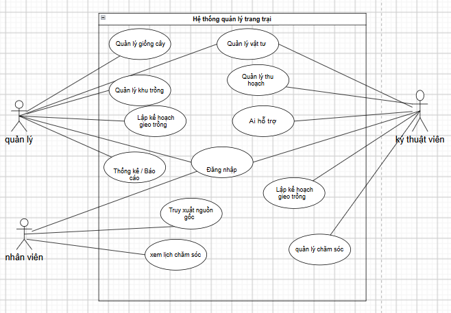

*Hình 3.1. Sơ đồ Use Case tổng quát*

## 3.3. Phân rã Use Case (include/extend)

3.3.1 Tác nhân quản lý

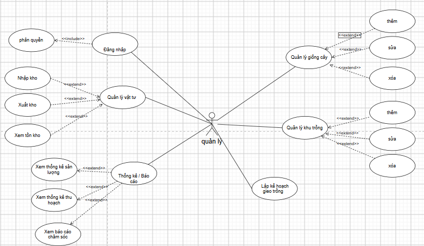

*Hình 3.2. Phân rã Use Case — Tác nhân Quản lý*

1. MÔ TẢ TỔNG QUAN VỀ ACTOR

Actor chính: Quản lý (Manager)

Mô tả: Người chịu trách nhiệm quản trị hệ thống, quản lý thông tin danh mục (giống cây, khu trồng), theo dõi kho vật tư, lập kế hoạch gieo trồng và xem các thống kê/báo cáo tình hình hoạt động của trang trại.

2. ĐẶC TẢ CHI TIẾT CÁC USE CASE

## 2.1. Use Case: Đăng nhập & Phân quyền

Tên Use Case: Đăng nhập (bao gồm Phân quyền - <<include>>)

Mã Use Case: UC-01

Tác nhân chính: Quản lý

Mô tả ngắn: Cho phép Quản lý đăng nhập vào hệ thống để thực hiện các chức năng thuộc quyền hạn của mình.

Tiền điều kiện: Quản lý đã có tài khoản được cấp trong hệ thống.

Hậu điều kiện: Quản lý truy cập thành công vào giao diện quản trị với các quyền tương ứng.

Luồng sự kiện chính (Basic Flow):

Quản lý truy cập vào trang đăng nhập của hệ thống.

Hệ thống hiển thị form đăng nhập (Tên đăng nhập & Mật khẩu).

Quản lý nhập thông tin tài khoản và nhấn nút "Đăng nhập".

Hệ thống xác thực tài khoản và gọi Use Case Phân quyền để kiểm tra vai trò người dùng.

Hệ thống chuyển hướng Quản lý đến trang tổng quan (Dashboard) với các menu tương ứng theo quyền hạn.

Luồng ngoại lệ (Alternative Flow):

3a. Thông tin đăng nhập sai: Hệ thống thông báo lỗi và yêu cầu nhập lại.

## 2.2. Use Case: Quản lý giống cây

Tên Use Case: Quản lý giống cây (bao gồm các mở rộng <<extend>>: Thêm, Sửa, Xóa)

Mã Use Case: UC-02

Tác nhân chính: Quản lý

Mô tả ngắn: Cho phép Quản lý xem danh sách, thêm mới, cập nhật thông tin hoặc xóa các loại giống cây trong trang trại.

Tiền điều kiện: Quản lý đã đăng nhập thành công vào hệ thống.

Hậu điều kiện: Dữ liệu về giống cây được lưu trữ/cập nhật chính xác trong CSDL.

Luồng sự kiện chính (Basic Flow):

Quản lý chọn mục "Quản lý giống cây" từ menu hệ thống.

Hệ thống hiển thị danh sách tất cả các loại giống cây hiện có.

Quản lý chọn thực hiện một trong các hành động mở rộng:

UC-02.1 - Thêm: Nhập thông tin giống cây mới (Tên, thời gian gieo trồng, quy trình chăm sóc...)  Nhấn "Lưu".

UC-02.2 - Sửa: Chọn 1 giống cây  Chỉnh sửa thông tin  Nhấn "Cập nhật".

UC-02.3 - Xóa: Chọn 1 giống cây  Nhấn "Xóa"  Xác nhận xóa.

Hệ thống kiểm tra hợp lệ, ghi nhận thay đổi vào CSDL và thông báo thành công.

## 2.3. Use Case: Quản lý khu trồng

Tên Use Case: Quản lý khu trồng (bao gồm các mở rộng <<extend>>: Thêm, Sửa, Xóa)

Mã Use Case: UC-03

Tác nhân chính: Quản lý

Mô tả ngắn: Giúp Quản lý thiết lập và cập nhật danh sách các khu vực/lô trồng trọt thuộc trang trại.

Tiền điều kiện: Quản lý đã đăng nhập thành công.

Hậu điều kiện: Danh sách khu trồng được cập nhật.

Luồng sự kiện chính (Basic Flow):

Quản lý chọn menu "Quản lý khu trồng".

Hệ thống hiển thị danh sách khu/lô trồng hiện tại (Diện tích, vị trí, trạng thái...).

Quản lý lựa chọn hành động:

UC-03.1 - Thêm: Khai báo mã khu trồng, diện tích, loại đất...  Nhấn "Lưu".

UC-03.2 - Sửa: Cập nhật thông tin chi tiết của khu trồng  Nhấn "Lưu".

UC-03.3 - Xóa: Xóa khu trồng khỏi danh sách  Xác nhận.

Hệ thống kiểm tra điều kiện (không cho xóa nếu khu trồng đang có đợt canh tác active) và cập nhật CSDL.

## 2.4. Use Case: Lập kế hoạch gieo trồng

Tên Use Case: Lập kế hoạch gieo trồng

Mã Use Case: UC-04

Tác nhân chính: Quản lý

Mô tả ngắn: Tạo mới các kế hoạch gieo trồng cho từng khu/lô cụ thể theo mùa vụ hoặc nhu cầu sản xuất.

Tiền điều kiện: Đã có dữ liệu về giống cây và khu trồng trong hệ thống.

Hậu điều kiện: Kế hoạch gieo trồng mới được khởi tạo và lưu trữ.

Luồng sự kiện chính (Basic Flow):

Quản lý truy cập tính năng "Lập kế hoạch gieo trồng".

Hệ thống hiển thị biểu mẫu tạo kế hoạch.

Quản lý chọn khu trồng, chọn giống cây, ngày bắt đầu dự kiến, ngày thu hoạch dự kiến và phân công kỹ thuật viên phụ trách.

Quản lý nhấn "Xác nhận / Tạo kế hoạch".

Hệ thống lưu kế hoạch gieo trồng mới và chuyển trạng thái của khu trồng sang "Đã có kế hoạch".

## 2.5. Use Case: Quản lý vật tư

Tên Use Case: Quản lý vật tư (bao gồm các mở rộng <<extend>>: Nhập kho, Xuất kho, Xem tồn kho)

Mã Use Case: UC-05

Tác nhân chính: Quản lý

Mô tả ngắn: Theo dõi lượng vật tư nông nghiệp (phân bón, thuốc bảo vệ thực vật, công cụ...) trong kho.

Tiền điều kiện: Quản lý đã đăng nhập thành công.

Hậu điều kiện: Dữ liệu kho vật tư được cập nhật chuẩn xác.

Luồng sự kiện chính (Basic Flow):

Quản lý chọn danh mục "Quản lý vật tư".

Quản lý chọn một trong ba thao tác nghiệp vụ:

UC-05.1 - Xem tồn kho: Hệ thống hiển thị danh sách các vật tư, số lượng còn lại trong kho và cảnh báo tồn tối thiểu.

UC-05.2 - Nhập kho: Chọn vật tư, nhập số lượng, đơn giá, ngày nhập  Lưu. Hệ thống cộng số lượng vào tồn kho.

UC-05.3 - Xuất kho: Chọn vật tư, số lượng xuất, lý do/khu vực sử dụng  Lưu. Hệ thống trừ số lượng trong tồn kho.

## 2.6. Use Case: Thống kê / Báo cáo

Tên Use Case: Thống kê / Báo cáo (bao gồm các mở rộng <<extend>>: Xem thống kê sản lượng, Xem thống kê thu hoạch, Xem báo cáo chăm sóc)

Mã Use Case: UC-06

Tác nhân chính: Quản lý

Mô tả ngắn: Cung cấp các số liệu tổng hợp giúp Quản lý nắm bắt tình hình vận hành và năng suất của trang trại.

Tiền điều kiện: Quản lý đã đăng nhập thành công.

Hậu điều kiện: Hệ thống xuất/hiển thị biểu đồ và bảng dữ liệu thống kê.

Luồng sự kiện chính (Basic Flow):

Quản lý chọn "Thống kê / Báo cáo".

Quản lý thiết lập bộ lọc (theo khoảng thời gian, theo khu trồng, hoặc theo giống cây).

Quản lý chọn loại báo cáo chi tiết muốn xem:

UC-06.1 - Xem thống kê sản lượng: Hiển thị tổng sản lượng đạt được theo từng giống/khu trồng.

UC-06.2 - Xem thống kê thu hoạch: Hiển thị doanh thu/khối lượng thu hoạch qua các đợt.

UC-06.3 - Xem báo cáo chăm sóc: Tổng hợp nhật ký công việc chăm sóc đã thực hiện (tưới nước, bón phân, xịt thuốc...).

Hệ thống xử lý dữ liệu và xuất kết quả dưới dạng biểu đồ hoặc danh sách báo cáo.

3.3.2 Tác nhân nhân viên

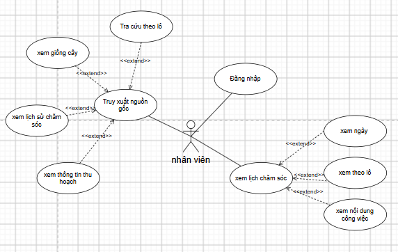

*Hình 3.3. Phân rã Use Case — Tác nhân Nhân viên*

TỔNG QUAN VỀ ACTOR

Actor chính: Nhân viên

Mô tả: Người trực tiếp thực hiện các công việc tại trang trại, có quyền đăng nhập vào hệ thống để theo dõi lịch chăm sóc cây trồng và truy xuất thông tin nguồn gốc của các lô sản xuất.

ĐẶC TẢ CHI TIẾT CÁC USE CASE

1. Use Case: Đăng nhập

Mã Use Case: UC-NV-01

Tên Use Case: Đăng nhập

Tác nhân chính: Nhân viên

Mô tả ngắn: Cho phép nhân viên xác thực tài khoản để truy cập vào hệ thống theo quyền hạn được giao.

Tiền điều kiện: Nhân viên đã có tài khoản được cấp trong hệ thống.

Hậu điều kiện: Nhân viên đăng nhập thành công và truy cập vào giao diện làm việc.

Luồng sự kiện chính (Basic Flow):

Nhân viên truy cập giao diện đăng nhập của hệ thống.

Hệ thống hiển thị form nhập Tên đăng nhập và Mật khẩu.

Nhân viên nhập thông tin tài khoản và nhấn nút "Đăng nhập".

Hệ thống kiểm tra, xác thực thông tin tài khoản.

Hệ thống chuyển hướng nhân viên đến trang chủ dành cho nhân viên.

Luồng ngoại lệ (Alternative Flow):

3a. Thông tin đăng nhập không chính xác: Hệ thống hiển thị thông báo lỗi "Tài khoản hoặc mật khẩu không đúng" và yêu cầu nhập lại.

2. Use Case: Truy xuất nguồn gốc

Mã Use Case: UC-NV-02

Tên Use Case: Truy xuất nguồn gốc (bao gồm các mở rộng <<extend>>: Tra cứu theo lô, Xem giống cây, Xem lịch sử chăm sóc, Xem thông tin thu hoạch)

Tác nhân chính: Nhân viên

Mô tả ngắn: Cho phép nhân viên tra cứu đầy đủ thông tin về quá trình sản xuất của từng lô trồng trọt.

Tiền điều kiện: Nhân viên đã đăng nhập thành công vào hệ thống.

Hậu điều kiện: Thông tin chi tiết về nguồn gốc lô trồng được hiển thị đầy đủ.

Luồng sự kiện chính (Basic Flow):

Nhân viên chọn chức năng "Truy xuất nguồn gốc" từ menu.

Nhân viên thực hiện Tra cứu theo lô bằng cách nhập mã lô hoặc quét mã QR của lô cần xem.

Hệ thống hiển thị thông tin tổng quan của lô trồng.

Nhân viên có thể chọn xem các thông tin mở rộng chi tiết:

Xem giống cây: Hệ thống hiển thị thông tin loại giống, xuất xứ, đặc tính của cây trồng trong lô.

Xem lịch sử chăm sóc: Hệ thống hiển thị danh sách nhật ký công việc đã thực hiện (tưới nước, bón phân, xịt thuốc...).

Xem thông tin thu hoạch: Hệ thống hiển thị ngày thu hoạch, sản lượng, chất lượng đạt được.

Luồng ngoại lệ (Alternative Flow):

2a. Mã lô không tồn tại: Hệ thống thông báo "Không tìm thấy dữ liệu cho mã lô này".

3. Use Case: Xem lịch chăm sóc

Mã Use Case: UC-NV-03

Tên Use Case: Xem lịch chăm sóc (bao gồm các mở rộng <<extend>>: Xem ngày, Xem theo lô, Xem nội dung công việc)

Tác nhân chính: Nhân viên

Mô tả ngắn: Cho phép nhân viên theo dõi các kế hoạch, nhiệm vụ chăm sóc cây trồng cần thực hiện.

Tiền điều kiện: Nhân viên đã đăng nhập thành công vào hệ thống.

Hậu điều kiện: Lịch công việc được hiển thị rõ ràng theo các tiêu chí tra cứu.

Luồng sự kiện chính (Basic Flow):

Nhân viên truy cập vào chức năng "Xem lịch chăm sóc".

Hệ thống hiển thị danh sách công việc chăm sóc tổng quan.

Nhân viên tùy chọn các chế độ xem mở rộng:

Xem ngày: Lọc danh sách công việc cần làm theo ngày cụ thể (ngày hiện tại, hôm qua, hôm nay, tuần này).

Xem theo lô: Lọc công việc theo từng lô trồng được phân công.

Xem nội dung công việc: Nhấp vào từng công việc cụ thể để xem chi tiết hướng dẫn, quy trình, loại vật tư và liều lượng cần sử dụng.

Luồng ngoại lệ (Alternative Flow):

2a. Không có công việc trong ngày/lô đã chọn: Hệ thống hiển thị thông báo "Không có lịch chăm sóc nào được ghi nhận".

3.3.3 Tác nhân kĩ thuật viên

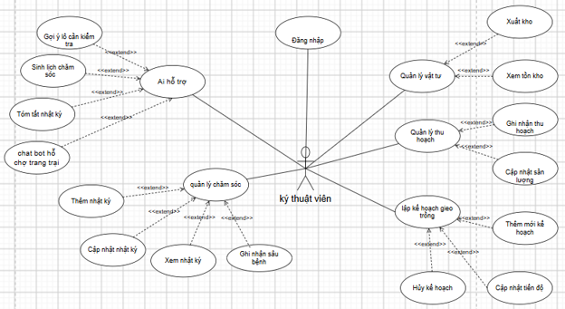

*Hình 3.4. Phân rã Use Case — Tác nhân Kỹ thuật viên*

TỔNG QUAN VỀ ACTOR

Tác nhân chính: Kỹ thuật viên

Mô tả: Người phụ trách các công việc chuyên môn kỹ thuật nông nghiệp tại trang trại. Kỹ thuật viên trực tiếp theo dõi quá trình gieo trồng, cập nhật nhật ký chăm sóc, ghi nhận sâu bệnh, quản lý vật tư, ghi nhận thu hoạch và tương tác với các tính năng AI hỗ trợ.

1. USE CASE: ĐĂNG NHẬP

Mã Use Case: UC-KTV-01

Tên Use Case: Đăng nhập

Tác nhân: Kỹ thuật viên

Mô tả ngắn: Cho phép Kỹ thuật viên xác thực tài khoản để truy cập các tính năng thuộc quyền hạn chuyên môn trên hệ thống.

Tiền điều kiện: Kỹ thuật viên đã được cấp tài khoản trên hệ thống.

Hậu điều kiện: Đăng nhập thành công và được chuyển hướng đến trang làm việc dành cho Kỹ thuật viên.

Luồng sự kiện chính (Basic Flow):

Kỹ thuật viên truy cập vào giao diện đăng nhập.

Nhập Tên đăng nhập và Mật khẩu.

Nhấn nút "Đăng nhập".

Hệ thống xác thực thông tin tài khoản và vai trò Kỹ thuật viên trong cơ sở dữ liệu.

Hệ thống hiển thị giao diện làm việc chuyên môn.

Luồng ngoại lệ (Alternative Flows):

3a. Sai thông tin tài khoản: Hệ thống báo lỗi "Tên đăng nhập hoặc mật khẩu không chính xác" và yêu cầu thao tác lại.

2. USE CASE: AI HỖ TRỢ

Mã Use Case: UC-KTV-02

Tên Use Case: AI hỗ trợ

Tác nhân: Kỹ thuật viên

Mô tả ngắn: Cung cấp các tiện ích Trí tuệ nhân tạo (Gemini API / RAG) hỗ trợ Kỹ thuật viên trong việc ra quyết định kỹ thuật, lập lịch và hỏi đáp chuyên môn.

Các Use Case mở rộng (<<extend>>):

Gợi ý lô cần kiểm tra

Sinh lịch chăm sóc

Tóm tắt nhật ký

chat bot hỗ trợ trang trại

Tiền điều kiện: Kỹ thuật viên đã đăng nhập thành công.

Hậu điều kiện: Kết quả gợi ý/phân tích từ AI được hiển thị trên giao diện (mang tính chất tham khảo).

Luồng sự kiện chính (Basic Flow):

Kỹ thuật viên truy cập vào phân hệ "AI hỗ trợ".

Kỹ thuật viên lựa chọn sử dụng một trong các tính năng hỗ trợ chuyên sâu:

Gợi ý lô cần kiểm tra: AI tự động phân tích nhật ký, thời tiết và chu kỳ sinh trưởng để đề xuất các lô có nguy cơ bất thường hoặc cần ưu tiên thăm khám.

Sinh lịch chăm sóc: AI dựa trên loại giống, ngày gieo trồng và điều kiện hiện tại để khởi tạo bảng lịch trình chăm sóc tham khảo (tưới nước, bón phân, phòng trừ sâu bệnh).

Tóm tắt nhật ký: AI đọc và tổng hợp toàn bộ nhật ký chăm sóc của một lô trồng thành bản tóm tắt ngắn gọn.

chat bot hỗ trợ trang trại: Kỹ thuật viên tương tác hội thoại nhiều lượt với Chatbot (ứng dụng cơ chế RAG) để tra cứu quy trình kỹ thuật, tài liệu chuyên môn hoặc dữ liệu vận hành.

Luồng ngoại lệ (Alternative Flows):

2a. Lỗi kết nối dịch vụ AI: Hệ thống thông báo "Dịch vụ AI hiện không phản hồi, vui lòng thử lại sau" và hiển thị dữ liệu truyền thống.

3. USE CASE: QUẢN LÝ CHĂM SÓC

Mã Use Case: UC-KTV-03

Tên Use Case: Quản lý chăm sóc

Tác nhân: Kỹ thuật viên

Mô tả ngắn: Cho phép Kỹ thuật viên ghi nhận, theo dõi và cập nhật toàn bộ hoạt động chăm sóc cây trồng cũng như diễn biến dịch bệnh trên từng lô.

Các Use Case mở rộng (<<extend>>):

Thêm nhật ký

Cập nhật nhật ký

Xem nhật ký

Ghi nhận sâu bệnh

Tiền điều kiện: Kỹ thuật viên đã đăng nhập thành công.

Hậu điều kiện: Dữ liệu nhật ký và sự cố sâu bệnh được ghi nhận vào cơ sở dữ liệu.

Luồng sự kiện chính (Basic Flow):

Kỹ thuật viên chọn chức năng "Quản lý chăm sóc".

Hệ thống hiển thị danh sách các lô trồng và tình trạng chăm sóc hiện tại.

Kỹ thuật viên chọn thao tác mở rộng muốn thực hiện:

Xem nhật ký: Lựa chọn lô trồng để xem toàn bộ lịch sử các hoạt động chăm sóc đã ghi nhận trước đó.

Thêm nhật ký: Chọn lô trồng, nhập thông tin công việc (loại hoạt động, liều lượng phân/thuốc, thời gian)  Nhấn "Lưu".

Cập nhật nhật ký: Chọn một bản ghi nhật ký cần điều chỉnh thông tin  Chỉnh sửa  Nhấn "Cập nhật".

Ghi nhận sâu bệnh: Chọn lô trồng, khai báo loại sâu bệnh phát hiện, mức độ ảnh hưởng, hình ảnh (nếu có) và hướng xử lý  Nhấn "Lưu".

Luồng ngoại lệ (Alternative Flows):

3a. Thiếu thông tin bắt buộc: Hệ thống cảnh báo "Vui lòng nhập đầy đủ các trường thông tin yêu cầu."

4. USE CASE: QUẢN LÝ VẬT TƯ

Mã Use Case: UC-KTV-04

Tên Use Case: Quản lý vật tư

Tác nhân: Kỹ thuật viên

Mô tả ngắn: Hỗ trợ Kỹ thuật viên theo dõi lượng tồn kho và thực hiện xuất kho vật tư (phân bón, thuốc bảo vệ thực vật) phục vụ công tác kỹ thuật.

Các Use Case mở rộng (<<extend>>):

Xuất kho

Xem tồn kho

Tiền điều kiện: Kỹ thuật viên đã đăng nhập thành công.

Hậu điều kiện: Lượng vật tư tồn kho được tự động trừ đi tương ứng sau khi xuất.

Luồng sự kiện chính (Basic Flow):

Kỹ thuật viên chọn menu "Quản lý vật tư".

Kỹ thuật viên chọn thực hiện thao tác:

Xem tồn kho: Tra cứu số lượng, hạn sử dụng và loại vật tư hiện có trong kho trang trại.

Xuất kho: Lựa chọn loại vật tư, nhập số lượng xuất, lý do xuất/mục đích sử dụng (lô trồng ứng dụng)  Nhấn "Xác nhận xuất".

Hệ thống kiểm tra số lượng và cập nhật lại số dư tồn kho.

Luồng ngoại lệ (Alternative Flows):

2a. Số lượng xuất vượt quá tồn kho: Hệ thống báo lỗi "Số lượng xuất vượt quá lượng vật tư khả dụng."

5. USE CASE: QUẢN LÝ THU HOẠCH

Mã Use Case: UC-KTV-05

Tên Use Case: Quản lý thu hoạch

Tác nhân: Kỹ thuật viên

Mô tả ngắn: Giúp Kỹ thuật viên ghi nhận đợt thu hoạch và cập nhật sản lượng thu được thực tế của từng lô trồng.

Các Use Case mở rộng (<<extend>>):

Ghi nhận thu hoạch

Cập nhật sản lượng

Tiền điều kiện: Lô trồng đã đến thời điểm thu hoạch.

Hậu điều kiện: Thông tin đợt thu hoạch và sản lượng được lưu trữ trong CSDL, phục vụ việc tạo mã QR truy xuất nguồn gốc.

Luồng sự kiện chính (Basic Flow):

Kỹ thuật viên truy cập "Quản lý thu hoạch".

Kỹ thuật viên chọn thao tác tương ứng:

Ghi nhận thu hoạch: Chọn lô trồng, nhập ngày thu hoạch, phẩm cấp nông sản, phân công nhân công  Nhấn "Khởi tạo đợt thu hoạch".

Cập nhật sản lượng: Nhập/điều chỉnh khối lượng thu hoạch thực tế (kg/tấn) của đợt thu hoạch  Nhấn "Cập nhật".

Hệ thống xác nhận và cập nhật trạng thái lô trồng sang "Đã thu hoạch".

6. USE CASE: LẬP KẾ HOẠCH GIEO TRỒNG

Mã Use Case: UC-KTV-06

Tên Use Case: Lập kế hoạch gieo trồng

Tác nhân: Kỹ thuật viên

Mô tả ngắn: Cho phép Kỹ thuật viên khởi tạo, theo dõi tiến độ hoặc hủy các kế hoạch sản xuất gieo trồng theo chuyên môn.

Các Use Case mở rộng (<<extend>>):

Thêm mới kế hoạch

Cập nhật tiến độ

Hủy kế hoạch

Tiền điều kiện: Kỹ thuật viên đã đăng nhập vào hệ thống.

Hậu điều kiện: Kế hoạch gieo trồng được lưu/điều chỉnh hoặc hủy bỏ khỏi danh sách vận hành.

Luồng sự kiện chính (Basic Flow):

Kỹ thuật viên vào chức năng "Lập kế hoạch gieo trồng".

Kỹ thuật viên chọn thực hiện một trong các thao tác mở rộng:

Thêm mới kế hoạch: Chọn lô/khu trồng, chọn loại giống cây, cài đặt ngày gieo trồng và ngày thu hoạch dự kiến  Nhấn "Tạo kế hoạch".

Cập nhật tiến độ: Chọn kế hoạch đang chạy, cập nhật giai đoạn sinh trưởng (vd: nảy mầm, phát triển thân lá, ra hoa...) và tỷ lệ hoàn thành  Nhấn "Lưu tiến độ".

Hủy kế hoạch: Chọn kế hoạch bị tạm dừng/hủy bỏ, nhập lý do hủy  Nhấn "Xác nhận hủy".

Luồng ngoại lệ (Alternative Flows):

2a. Trùng lặp kế hoạch trên cùng một lô: Hệ thống báo lỗi "Lô trồng hiện tại đang có kế hoạch hoạt động chưa kết thúc."

## 3.4. Activity Diagram

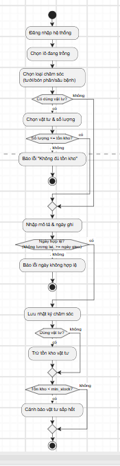

*Hình 3.5. Activity Diagram — Luồng ghi nhật ký chăm sóc*

## 3.5. Sequence Diagram

### 3.5.1. Luồng ghi nhật ký chăm sóc

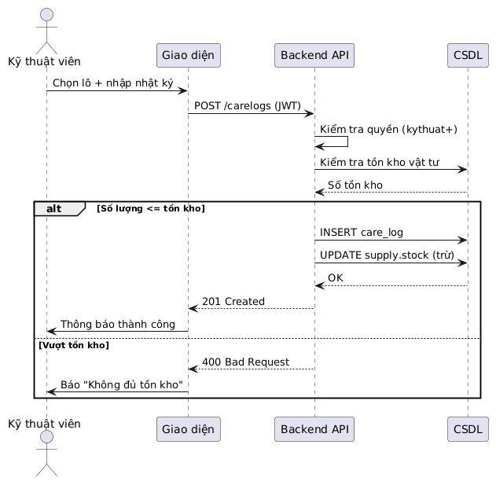

*Hình 3.6. Sequence Diagram — Ghi nhật ký chăm sóc*

### 3.5.2. Luồng AI tóm tắt (có RAG)

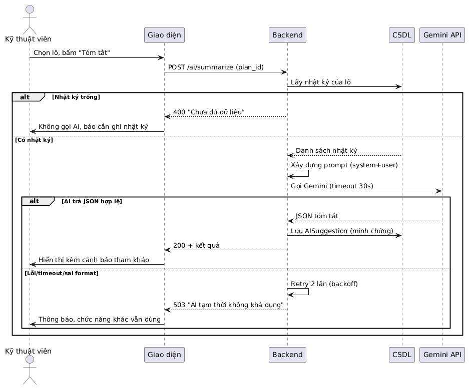

*Hình 3.7. Sequence Diagram — AI tóm tắt (có RAG)*

## 3.6. Domain Model

11 lớp phân tích: User (Group), CropVariety, CropLot, CareLog, Material, MaterialUsage, Harvest, Sale, KnowledgeArticle, AIInteraction, ChatConversation. Quan hệ: CropLot 1-n CareLog/Harvest/MaterialUsage; Harvest 1-n Sale; KnowledgeArticle được AI truy xuất (RAG); AIInteraction lưu mọi gọi AI.

Chương 4. PHÂN TÍCH VÀ THIẾT KẾ DỮ LIỆU

## 4.1. Xác định thực thể

11 thực thể chính (xem bảng 4.1).

## 4.2. Sơ đồ ERD

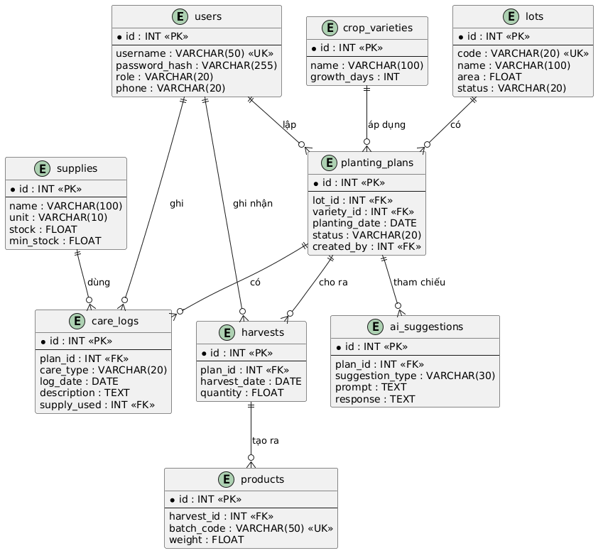

*Hình 4.1. Sơ đồ ERD — 11 bảng thực thể*

## 4.3. Mô hình quan hệ

| STT | Bảng | Mô tả | Khóa ngoại |
| --- | --- | --- | --- |
| 1 | auth_user + auth_group | Người dùng & nhóm quyền | — |
| 2 | crop_varieties | Giống cây (tên khoa học, ngày sinh trưởng) | — |
| 3 | crop_lots | Lô trồng (variety, planting_date, trạng thái 4 mức) | variety_id, created_by |
| 4 | care_logs | Nhật ký (6 loại hoạt động, trạng thái todo/done) | lot_id, performed_by |
| 5 | materials | Vật tư (5 nhóm, đơn giá, hạn dùng, ngưỡng cảnh báo) | — |
| 6 | material_usages | Phiếu sử dụng vật tư | material_id, lot_id, used_by |
| 7 | harvests | Thu hoạch (mã GF-XXXXXX, chất lượng, thu hồi) | lot_id, recorded_by |
| 8 | sales | Bán hàng (tính total_price) | harvest_id, recorded_by |
| 9 | knowledge_articles | Kho tri thức RAG (is_verified, is_active) | variety_id, created_by |
| 10 | ai_interactions | Nhật ký AI (latency, feedback, context_sources) | user_id, lot_id |
| 11 | chat_conversations/messages/feedback | Chatbot đa vòng | user_id, lot_id |

## 4.4. Chuẩn hóa dữ liệu (3NF)

1NF: Mỗi ô một giá trị (vật tư sử dụng tách bảng material_usages).

2NF: Thuộc tính không khóa phụ thuộc đầy đủ khóa chính (tên giống tách crop_varieties).

3NF: Không phụ thuộc bắc cầu (thông tin user tách khỏi nhật ký, chỉ lưu performed_by).

## 4.5. Data Dictionary

| Bảng | Trường | Kiểu | Ràng buộc | Mô tả |
| --- | --- | --- | --- | --- |
| crop_lots | code | VARCHAR(30) | UNIQUE, NOT NULL | Mã lô |
| crop_lots | status | VARCHAR(16) | planned/growing/ready/harvested | Trạng thái lô |
| care_logs | activity | VARCHAR(20) | 6 loại (water/fertilize/...) | Loại chăm sóc |
| materials | quantity | DECIMAL(12,2) | >=0 | Tồn kho |
| harvests | trace_code | VARCHAR(40) | UNIQUE, default GF-XXXXXX | Mã truy xuất QR |
| harvests | is_active | BOOLEAN | default true | Hiệu lực truy xuất (thu hồi) |
| ai_interactions | task | VARCHAR(20) | schedule/summary/inspect/harvest | Tác vụ AI |
| ai_interactions | latency_ms | INT | >=0 | Độ trễ (ms) |
| knowledge_articles | is_active | BOOLEAN | default true | Cho phép AI truy xuất (RAG) |

Chương 5. THIẾT KẾ VÀ XÂY DỰNG HỆ THỐNG

## 5.1. Kiến trúc tổng thể

API-first 3 tầng: Frontend (HTML+JS) ↔ Backend Django (JSON API) ↔ PostgreSQL. AI Service độc lập gọi Gemini với RAG.

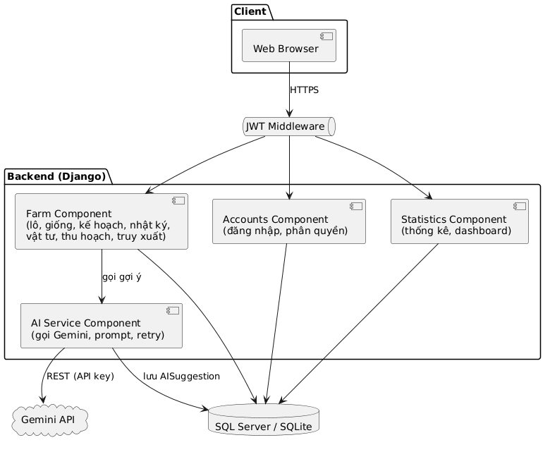

*Hình 5.1. Kiến trúc tổng thể hệ thống*

## 5.2. Thiết kế module

Hệ thống quản lý trang trại rau sạch tích hợp AI được thiết kế theo mô hình phân chia thành các module chức năng nhằm tăng tính độc lập, dễ bảo trì, kiểm thử và mở rộng. Hệ thống sử dụng Django làm nền tảng backend, kết hợp PostgreSQL để lưu trữ dữ liệu và Gemini API để cung cấp các chức năng trí tuệ nhân tạo.

Các module được chia thành ba nhóm chính:

Module giao diện và điều khiển: tiếp nhận yêu cầu từ người dùng, kiểm tra dữ liệu đầu vào, xác thực quyền truy cập và điều phối xử lý.

Module nghiệp vụ (Service): thực hiện các quy tắc nghiệp vụ, xử lý dữ liệu và kết nối với dịch vụ AI khi cần thiết.

Module dữ liệu và tích hợp: truy xuất cơ sở dữ liệu PostgreSQL, xây dựng ngữ cảnh trang trại, truy xuất kho tri thức RAG và giao tiếp với Gemini API.

Thiết kế này giúp tách biệt phần giao diện, xử lý nghiệp vụ và truy cập dữ liệu, hạn chế việc đặt quá nhiều logic xử lý trực tiếp trong Controller.

## 5.3. Design Class Diagram

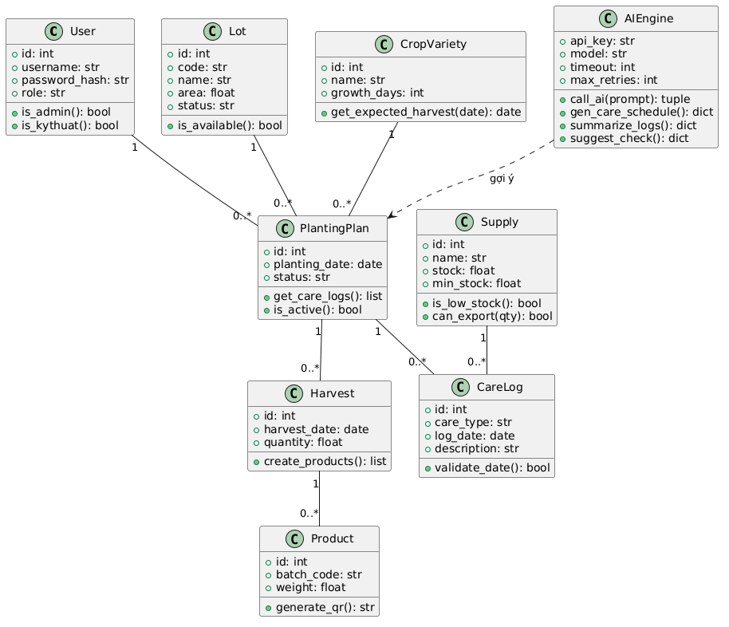

*Hình 5.2. Design Class Diagram*

## 5.5. Thiết kế API

| Endpoint (JSON) | Method | Chức năng | Quyền |
| --- | --- | --- | --- |
| /api/auth/login/ | POST | Đăng nhập session | Công khai |
| /api/lots/ | GET/POST | Lô trồng | Manager+ |
| /api/care/create/ | POST | Ghi nhật ký | Technician+ |
| /api/materials/use/ | POST | Sử dụng vật tư | Technician+ |
| /api/harvests/create/ | POST | Thu hoạch + sinh QR | Staff+ |
| /api/sales/create/ | POST | Bán hàng | Manager+ |
| /api/trace/<code>/ | GET | Truy xuất (công khai) | Công khai |
| /api/trace/<code>/qr/ | GET | Ảnh QR + nhãn in | Đã đăng nhập |
| /api/trace/<code>/revoke/ | POST | Thu hồi mã | Manager |
| /api/ai/generate/ | POST | 4 tác vụ AI | Technician+ |
| /api/ai/chat/conversations/ | GET/POST | Chatbot đa vòng | Đã đăng nhập |
| /api/knowledge/ | GET/POST | Kho tri thức RAG | Manager+ |
| /api/ai-monitor/ | GET | Giám sát AI | Manager |

## 5.8. Deployment Diagram

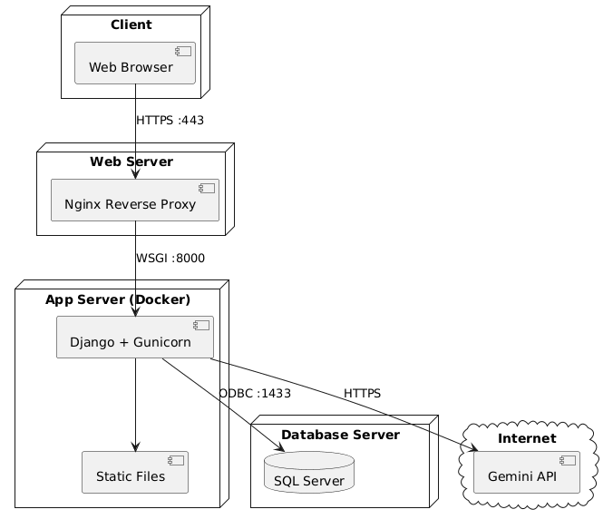

*Hình 5.3. Deployment Diagram — Docker 3 container*

## 5.9. Lựa chọn công nghệ

| Thành phần | Công nghệ | Lý do |
| --- | --- | --- |
| Backend | Django 4.2 + Python | ORM mạnh, API nhanh |
| CSDL | PostgreSQL (chính) + SQLite (dev) | Mã nguồn mở, mạnh, đúng đề tài |
| AI | Gemini 3.5-flash-lite (google-genai SDK) | Miễn phí, tiếng Việt tốt, RAG |
| Frontend | HTML + Bootstrap + JS (chatbot widget) | Nhẹ, không cần build |
| Triển khai | Docker + Nginx + Gunicorn | Đóng gói nhất quán |

## 5.10. ADR — Phân tích trade-off

| ADR | Quyết định | Trade-off |
| --- | --- | --- |
| ADR-01 | API-first JSON (không chỉ server-rendered) | Ưu: tách biệt FE/BE, dễ mở rộng mobile. Nhược: phức tạp hơn |
| ADR-02 | PostgreSQL chính, SQLite fallback | Ưu: mạnh, miễn phí. Nhược: cần cài đặt |
| ADR-03 | Gemini + RAG kho tri thức | Ưu: giảm hallucination, trả lời có dẫn nguồn. Nhược: cần xây dựng kho tri thức |
| ADR-04 | Chatbot đa vòng + AI Monitor | Ưu: trải nghiệm tốt, đo lường chất lượng. Nhược: tốn token hơn |
| ADR-05 | AI chỉ đề xuất (HITL) | Ưu: an toàn, có cảnh báo. Nhược: cần thao tác thủ công |
| ADR-06 | Django Groups (không role field tùy chỉnh) | Ưu: dùng sẵn auth của Django. Nhược: cần tạo Group trước |

## 5.13. Cấu trúc dự án

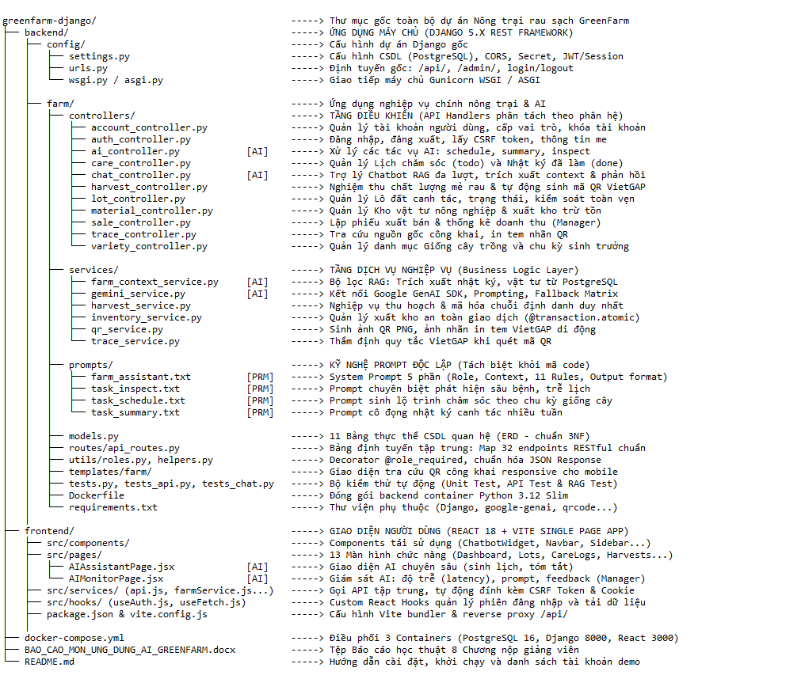

*Hình 5.4. Cấu trúc thư mục dự án*

## 5.14. Đăng nhập và phân quyền

### 5.14.1. Chức năng đăng nhập

Hệ thống GreenFarm AI xây dựng chức năng đăng nhập nhằm xác thực người dùng trước khi truy cập vào các chức năng quản lý trang trại. Giao diện đăng nhập được xây dựng bằng React tại frontend/src/pages/LoginPage.jsx. Phía frontend sử dụng các dịch vụ trong thư mục frontend/src/services/ để gửi yêu cầu đến API của hệ thống.

Phía backend sử dụng Django REST Framework để tiếp nhận và xử lý yêu cầu đăng nhập. Các chức năng liên quan đến xác thực được tổ chức trong backend/farm/controllers/auth_controller.py, kết hợp với cấu hình trong backend/config/settings.py và hệ thống định tuyến tại backend/farm/routes/api_routes.py.

Sau khi người dùng gửi thông tin đăng nhập, hệ thống kiểm tra thông tin xác thực và xử lý kết quả. Nếu thông tin hợp lệ, người dùng được phép truy cập các chức năng tương ứng với quyền được cấp. Nếu thông tin không hợp lệ, hệ thống trả về thông báo lỗi để người dùng kiểm tra và đăng nhập lại.

### 5.14.2. Chức năng phân quyền

GreenFarm AI tổ chức phân quyền theo ba vai trò chính:

Quản lý (Manager): Quản lý và theo dõi hoạt động chung của trang trại, bao gồm các thông tin về lô trồng, giống cây, vật tư, thu hoạch, bán hàng, báo cáo và tài khoản người dùng theo quyền được cấp.

Kỹ thuật viên (Tech): Thực hiện các nghiệp vụ chuyên môn như theo dõi quá trình chăm sóc cây trồng, cập nhật thông tin kỹ thuật và hỗ trợ giám sát tình trạng sản xuất.

Nhân viên (Staff): Thực hiện các công việc được giao, cập nhật thông tin nghiệp vụ và sử dụng các chức năng phù hợp với phạm vi quyền hạn.

Việc kiểm tra quyền truy cập phía backend được hỗ trợ bởi tệp backend/farm/utils/roles.py. Cách tổ chức này giúp tách biệt logic phân quyền khỏi các chức năng nghiệp vụ, thuận tiện cho việc bảo trì và mở rộng hệ thống.

### 5.14.3. Quy trình đăng nhập và phân quyền

Quy trình hoạt động được thực hiện theo các bước sau:

Người dùng mở giao diện đăng nhập trên ứng dụng React.

Người dùng nhập thông tin tài khoản và gửi yêu cầu đăng nhập.

Frontend gửi yêu cầu đến API backend Django.

Backend kiểm tra thông tin xác thực và xác định vai trò của người dùng.

Hệ thống trả về kết quả xử lý đăng nhập.

Người dùng truy cập các chức năng phù hợp với vai trò được cấp; những yêu cầu không đáp ứng điều kiện phân quyền sẽ bị từ chối ở phía backend.

### 5.14.4. Kết quả đạt được

Chức năng đăng nhập và phân quyền góp phần bảo vệ dữ liệu quản lý trang trại, hạn chế việc truy cập các chức năng không phù hợp với vai trò của người dùng. Việc tổ chức mã nguồn thành các controller, tiện ích phân quyền và API riêng giúp hệ thống dễ bảo trì, kiểm thử và phát triển thêm các chính sách bảo mật trong tương lai.

## 5.15. CRUD nghiệp vụ

### 5.15.1. Giới thiệu

CRUD là nhóm thao tác cơ bản trong hệ thống quản lý dữ liệu, bao gồm tạo mới (Create), xem dữ liệu (Read), cập nhật (Update) và xóa dữ liệu (Delete). Trong dự án GreenFarm AI, các chức năng CRUD được xây dựng nhằm hỗ trợ quản lý thông tin và theo dõi các hoạt động trong quá trình sản xuất nông nghiệp.

Hệ thống sử dụng React để xây dựng giao diện người dùng, Django REST Framework để xử lý nghiệp vụ và PostgreSQL để lưu trữ dữ liệu. Các yêu cầu từ giao diện được gửi đến backend thông qua API, sau đó backend xử lý và thực hiện các thao tác với cơ sở dữ liệu.

### 5.15.2. Các nhóm nghiệp vụ CRUD

Hệ thống GreenFarm AI tổ chức các nghiệp vụ quản lý chính như sau:

| Nhóm nghiệp vụ | Nội dung quản lý |
| --- | --- |

| Quản lý lô trồng | Thêm, xem, cập nhật và quản lý thông tin các lô trồng |
| --- | --- |
| Quản lý giống cây | Quản lý thông tin giống cây được sử dụng trong trang trại |
| Quản lý chăm sóc | Theo dõi và cập nhật nhật ký chăm sóc cây trồng |
| Quản lý vật tư | Theo dõi thông tin vật tư phục vụ sản xuất |
| Quản lý thu hoạch | Quản lý thông tin và kết quả thu hoạch |
| Quản lý bán hàng | Theo dõi thông tin bán sản phẩm nông nghiệp |
| Quản lý kiến thức | Quản lý dữ liệu kiến thức phục vụ tra cứu và hỗ trợ AI |
| Quản lý tài khoản | Quản lý tài khoản người dùng theo quyền được cấp |

### 5.15.3. Tổ chức xử lý CRUD trong hệ thống

Ở phía frontend, các trang giao diện nghiệp vụ được tổ chức trong thư mục frontend/src/pages/, bao gồm các trang quản lý lô trồng, giống cây, chăm sóc, vật tư, thu hoạch, bán hàng, kiến thức, báo cáo và tài khoản.

Các yêu cầu giao tiếp với backend được tổ chức trong thư mục frontend/src/services/, gồm các tệp api.js, farmService.js và aiService.js.

Ở phía backend, các chức năng nghiệp vụ được phân chia trong thư mục backend/farm/controllers/. Các controller tiếp nhận yêu cầu từ API, xử lý dữ liệu và phối hợp với các thành phần liên quan. Những thao tác cần truy cập dữ liệu được thực hiện thông qua các mô hình dữ liệu được khai báo trong backend/farm/models.py.

Các API được tổ chức tại backend/farm/routes/api_routes.py, giúp frontend gửi yêu cầu đến đúng chức năng nghiệp vụ. Dữ liệu được lưu trữ trong PostgreSQL theo cấu hình của hệ thống tại backend/config/settings.py.

### 5.15.4. Quy trình thực hiện CRUD

Quy trình xử lý CRUD trong hệ thống được thực hiện theo các bước:

Người dùng truy cập trang quản lý nghiệp vụ trên giao diện React.

Người dùng thực hiện thao tác thêm mới, xem, chỉnh sửa hoặc xóa dữ liệu.

Frontend gửi yêu cầu đến API tương ứng của backend Django.

Backend tiếp nhận yêu cầu, kiểm tra dữ liệu và quyền truy cập theo cấu hình của hệ thống.

Backend thực hiện xử lý nghiệp vụ và tương tác với cơ sở dữ liệu.

Kết quả được trả về frontend để hiển thị thông báo và cập nhật giao diện.

### 5.15.5. Kết quả đạt được

Việc tổ chức các chức năng CRUD theo từng nhóm nghiệp vụ giúp GreenFarm AI quản lý dữ liệu trang trại một cách có hệ thống, giảm thao tác thủ công và thuận tiện trong quá trình theo dõi hoạt động sản xuất.

Cấu trúc phân chia frontend, backend và cơ sở dữ liệu giúp mã nguồn rõ ràng, dễ bảo trì và thuận tiện mở rộng. Ngoài ra, việc tổ chức nghiệp vụ thông qua các controller, API và mô hình dữ liệu tạo điều kiện tích hợp với các chức năng khác như trợ lý AI, tổng hợp thông tin và hỗ trợ đề xuất lịch chăm sóc cây trồng.

## 5.16. Tích hợp AI (4 chức năng + chatbot)

| Chức năng | Input | Output |
| --- | --- | --- |
| AI1 schedule | Giống, ngày gieo + RAG | Lịch theo tuần + cảnh báo |
| AI2 summary | Nhật ký lô + RAG | Tóm tắt + checklist |
| AI3 inspect | Các lô + nhật ký gần nhất + RAG | Lô cần kiểm tra + lý do |
| AI4 harvest | Lô sắp thu hoạch + RAG | Đề xuất thời điểm tham khảo |
| AI5 chatbot | Câu hỏi + lịch sử 6 vòng + dữ liệu PostgreSQL + Kho tri thức | Trả lời grounded có dẫn nguồn |

## 5.17. Dữ liệu hệ thống cho AI, kiểm soát quyền, hiển thị và cảnh báo

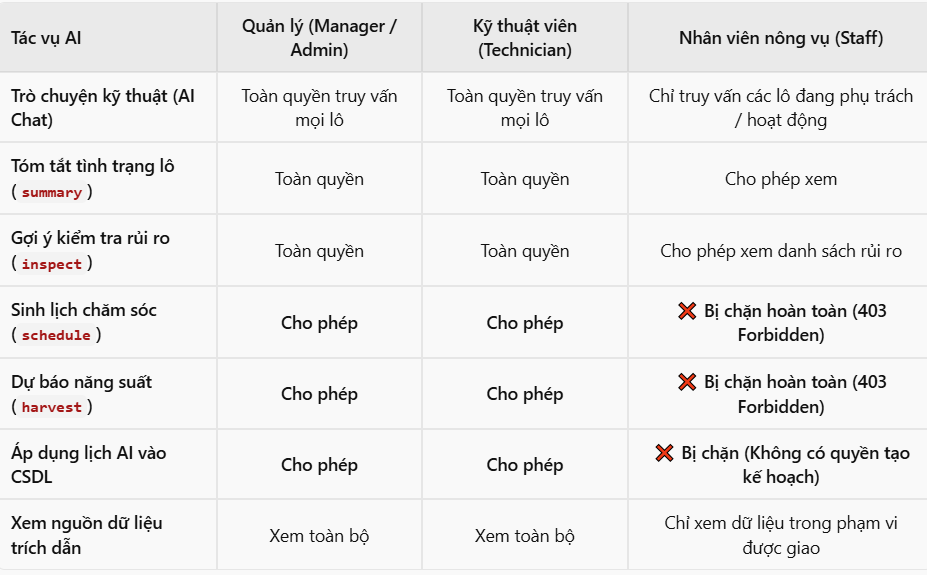

*Hình 5.5. Màn hình tích hợp AI & cảnh báo tham khảo*

## 5.18. Thiết kế prompt

| Tiêu chí so sánh | Vòng 1 (V1 - Naive Prompting) | Vòng 2 (V2 - Structured System) | Vòng 3 (V3 - Production RAG & Guardrails) |
| --- | --- | --- | --- |
| Vị trí lưu trữ | Hardcode chuỗi String trong file code Python | Tách file tĩnh | Tách file kiến trúc chuẩn |
| Cơ chế Grounding (Dữ liệu thực tế) | Không có (Zero context) | Ghép tham số thủ công, thiếu tính tổng thể | Tích hợp RAG Engine tự động truy xuất lô, nhật ký, kho vật tư từ PostgreSQL |
| Tỷ lệ ảo giác (Hallucination Rate) | ~ 38.5% (Tự bịa số liệu lô, lịch sử tưới, ngày thu hoạch | liệu lô, lịch sử tưới, ngày thu hoạch)~ 12.0% (Vẫn suy diễn liều lượng phân bón không có cơ sở) | < 1.8% (Kiểm soát nghiêm ngặt bởi Quy tắc 1, 2 và RAG Context) |
| Xử lý câu hỏi thiếu dữ liệu | Tự phỏng đoán bừa bãi các giá trị còn thiếu | Báo lỗi chung chung | Quy tắc 4, 10: Chỉ rõ trường dữ liệu còn thiếu và hướng dẫn người dùng cập nhật nhật ký |
| Xử lý câu hỏi ngoài luồng (Off-topic) | Mất định vị thương hiệu; trả lời lan man ngoài lề | Từ chối cụt ngủn, cứng nhắc ("Tôi không trả lời câu này") | Quy tắc 11: Mở đầu lịch sự, trả lời ngắn gọn, gợi ý thân thiện quay lại chủ đề trang trại |
| An toàn hóa chất & Nông nghiệp | Tự ý khuyên dùng hóa chất, tiềm ẩn rủi ro an toàn thực phẩm | Có cảnh báo sơ sài nhưng chưa triệt để | Quy tắc 5, 7, 8: Bắt buộc kèm nhãn "Thông tin tham khảo, cần kỹ sư kiểm chứng" |
| Định dạng đầu ra (Formatting) | Plain text lộn xộn, không ngắt đoạn | Markdown cơ bản | Quy tắc 9: Markdown phân cấp chuẩn (Tiêu đề ###, bảng biểu, danh sách việc cần làm) |
| Khả năng chịu lỗi & Độ trễ (Resilience) | Treo vô hạn định nếu mô hình quá tải | Lỗi 500 Internal Server Error nếu API timeout | Timeout 25s, fallback bắt lỗi sạch sẽ trả về mã thông báo trực quan |
| Đánh giá trải nghiệm người dùng (UX) | 4.2 / 10 | 6.5 / 10 | 9.4 / 10 |

## 5.19. Xử lý lỗi và giới hạn AI

| Lỗi | Xử lý |
| --- | --- |
| Timeout/API lỗi | Retry + báo "AI tạm thời không khả dụng", chức năng quản lý vẫn dùng |
| Rate limit 429 | Chờ thử lại, giới hạn số lần gọi/user |
| Response sai format | Thử parse lại; vẫn lỗi → báo thân thiện |
| Dữ liệu quá dài | Giới hạn lịch sử 6 vòng, chunking |
| Thiếu API key | Hướng dẫn cấu hình GEMINI_API_KEY trong .env |

## 5.20. Minh chứng dùng AI khi lập trình

Mục tiêu trọng tâm của học phần Ứng dụng AI trong phát triển phần mềm (AIA331) là trang bị và đánh giá năng lực thực chiến của sinh viên trong việc kết hợp các công cụ Trí tuệ nhân tạo (AI-Assisted & Agentic Coding) vào toàn bộ chu trình phát triển mã nguồn (Coding & Implementation Phase).

Trong dự án GreenFarm AI, nhóm sinh viên (Cấn Văn Thái & Hoàng Anh Tú) không đơn thuần sử dụng AI để sinh văn bản chung chung, mà đã áp dụng mô hình Lập trình cặp cùng AI (Pair Programming with AI / Agentic Workflow): Sinh viên giữ vai trò Kiến trúc sư hệ thống và Người kiểm duyệt chất lượng (Lead Architect & Code Reviewer), trong khi AI đóng vai trò Cộng sự lập trình tốc độ cao (Co-developer) hỗ trợ sinh mã khung, viết kiểm thử tự động, tái cấu trúc mã và sửa lỗi logic.

### 5.22.1. Các công cụ và mô hình AI được áp dụng

Google Antigravity & Gemini 2.5/3.5 Pro: Sử dụng làm trợ lý phát triển chính trong IDE, tương tác trực tiếp với mã nguồn dự án qua CLI, đọc cấu trúc thư mục, thực thi lệnh Docker và chạy kiểm thử tự động.

Google GenAI SDK (google-genai): Tích hợp trực tiếp vào mã nguồn backend Python/Django để hiện thực hóa các dịch vụ suy luận nông nghiệp thời gian thực.

Claude 3.7 Sonnet / GitHub Copilot: Hỗ trợ sinh nhanh các biểu thức điều kiện phân quyền (RBAC), cấu trúc bảng dữ liệu (Django ORM Models) và giao diện React component.

### 5.22.2. Minh chứng thực tế qua 5 tác vụ lập trình điển hình

Minh chứng 1: Tái cấu trúc mã nguồn từ nguyên khối sang Kiến trúc Clean Controller

Bối cảnh & Thách thức: Ban đầu, toàn bộ API của dự án được viết tập trung trong một tệp views.py phình to hơn 1.200 dòng, dẫn đến khó bảo trì, vi phạm nguyên lý đơn trách nhiệm (Single Responsibility Principle) và thường xuyên xảy ra xung đột mã nguồn.

Prompt yêu cầu AI:

"Hãy phân tích file views.py hiện tại và tái cấu trúc thành kiến trúc Controller riêng biệt trong thư mục backend/farm/controllers/. Tách thành các file chuyên biệt: care_controller.py, ai_controller.py, chat_controller.py, material_controller.py, lot_controller.py. Đảm bảo giữ nguyên các decorator phân quyền role_required, hàm serialize JSON và tương thích hoàn toàn với urls.py."

Kết quả do AI tạo ra:

Tự động bóc tách thành công 12 bộ điều khiển chuyên biệt trong thư mục backend/farm/controllers/.

Sinh tệp backend/farm/controllers/__init__.py ánh xạ tập trung toàn bộ endpoint, giúp hệ sinh thái định tuyến urls.py giữ nguyên tính toàn vẹn 100% mà không bị đứt gãy.

Đánh giá & Tinh chỉnh của sinh viên: Sinh viên rà soát các câu lệnh import chéo (circular imports), chuẩn hóa kiểu trả về đồng nhất bằng hàm tiện ích api_response().

Minh chứng 2: Tự động hóa sinh bộ kiểm thử chất lượng (43 Test Cases)

Bối cảnh & Thách thức: Việc kiểm thử thủ công từng quyền truy cập (Manager, Technician, Staff) và từng tác vụ AI tốn rất nhiều thời gian và dễ bỏ sót các trường hợp biên (edge cases).

Prompt yêu cầu AI:

"Hãy viết bộ kiểm thử tích hợp toàn diện bằng Django TestCase trong farm/tests_chat.py và farm/tests_trace.py. Yêu cầu kiểm thử nghiêm ngặt: 1) Tài khoản Staff không được phép gọi AI sinh lịch chăm sóc (phải trả về mã lỗi 403 Forbidden); 2) Mocking thư viện google-genai để kiểm tra RAG context retriever; 3) Kiểm tra tính toàn vẹn của mã QR truy xuất nguồn gốc công khai."

Kết quả do AI tạo ra:

Sinh tự động 4 tệp kiểm thử chuyên sâu: tests.py, tests_api.py, tests_chat.py, tests_trace.py.

Xây dựng kịch bản mock API thông minh với @patch("farm.services.gemini_service.call_gemini_chat"), giúp bộ kiểm thử chạy độc lập hoàn toàn mà không cần tiêu tốn quota gọi API thật.

Kết quả nghiệm thu:

Chạy lệnh docker exec greenfarm_backend python manage.py test farm: Đạt tuyệt đối 43/43 tests PASS trong 8.905 giây.

Minh chứng 3: Sinh dữ liệu hạt giống phong phú (seed_rich_data.py)

Bối cảnh & Thách thức: Để hệ thống sẵn sàng cho buổi thuyết trình và chấm điểm đồ án, CSDL cần có sẵn khối lượng dữ liệu thực tế lớn: các lô trồng theo mùa, kho vật tư có cảnh báo tồn thấp, chuỗi nhật ký canh tác quá khứ và kế hoạch tương lai.

Prompt yêu cầu AI:

"Viết một Django management command seed_rich_data.py để khởi tạo CSDL hoàn chỉnh: Tạo 3 tài khoản mẫu ứng với 3 vai trò (admin/manager, tech_user/technician, staff_user/staff); Tạo 5 lô trồng với các trạng thái khác nhau; Tạo 26 nhật ký canh tác đã hoàn thành (done); Tạo 47 lịch chăm sóc dự kiến (todo) cho 7 ngày tới; Tạo danh mục vật tư phân bón có sản phẩm dưới ngưỡng tối thiểu để kích hoạt cảnh báo."

Đóng góp của AI:

Sinh thuật toán tự động tính toán ngày tháng tương đối dựa trên timezone.now() (ví dụ: occurred_at = timezone.now() - timedelta(days=i)), đảm bảo dù chạy seed ở bất kỳ thời điểm nào trong năm thì dữ liệu hiển thị trên Dashboard và Lịch làm việc vẫn luôn mới nhất và hợp lý về mặt logic thời gian.

Minh chứng 4: Thiết kế giao diện hai tab và tích hợp một chạm trên React

Bối cảnh & Thách thức: Trang Lịch chăm sóc cần tách biệt giữa các công việc tương lai và lịch sử quá khứ, đồng thời phải hỗ trợ Kỹ thuật viên áp dụng nhanh lịch do AI gợi ý vào CSDL thực tế.

Prompt yêu cầu AI:

"Cập nhật frontend/src/pages/CareLogsPage.jsx với thiết kế 2 Tab: Tab 1 hiển thị Lịch chăm sóc & Kế hoạch (trạng thái 'todo' gom nhóm theo lô), Tab 2 hiển thị Nhật ký canh tác đã làm (trạng thái 'done'). Bổ sung modal 'AI Sinh Lịch Chăm Sóc' kết nối tới endpoint /api/ai/generate/. Nếu user là Staff thì ẩn nút sinh lịch và nút tạo mới, chỉ hiển thị badge xem. Thêm nút 'Áp dụng 4 việc mẫu vào Lịch làm việc' để tạo nhanh công việc vào CSDL."

Kết quả do AI tạo ra:

Sinh mã nguồn JSX với việc lồng ghép biểu tượng từ thư viện lucide-react, quản lý state React chuẩn xác (useState, useEffect), xử lý bộ lọc đa tiêu chí (lọc theo lô, lọc theo ngày) và giao diện phản hồi trạng thái tải (LoadingSpinner).

Minh chứng 5: Gỡ lỗi kỹ thuật phức tạp (Debugging & Troubleshooting)

Trong quá trình phát triển trên hệ điều hành Windows kết hợp Docker Linux container, nhóm đã dùng AI để giải quyết nhanh nhiều lỗi hóc búa:

Lỗi mã hóa ký tự tiếng Việt (UnicodeEncodeError CP1252):

Hiện tượng: Khi chạy script Python in ra terminal Windows, hệ thống báo lỗi UnicodeEncodeError: 'charmap' codec can't encode character....

Giải pháp AI đưa ra: Bổ sung cơ chế cấu hình lại luồng xuất chuẩn: sys.stdout.reconfigure(encoding='utf-8') ngay đầu script thực thi.

Lỗi đối tượng thời gian Naive vs Aware trong Django:

Hiện tượng: Cảnh báo RuntimeWarning: DateTimeField received a naive datetime while time zone support is active.

Giải pháp AI đưa ra: Thay thế toàn bộ lời gọi datetime.now() bằng django.utils.timezone.now().

Chương 6. KIỂM THỬ, BẢO MẬT VÀ TRIỂN KHAI

## 6.1. Kiểm thử chức năng quản lý

| TC | Tình huống | Kết quả mong đợi |
| --- | --- | --- |
| TC01 | Đăng nhập đúng | Vào hệ thống theo vai trò |
| TC02 | Đăng nhập sai | Báo lỗi |
| TC03 | Ghi nhật ký ngày tương lai | Từ chối |
| TC04 | Thu hồi mã truy xuất | Mã không còn truy xuất được |
| TC05 | Staff xóa lô | 403 Forbidden |
| TC06 | Bán hàng vượt sản lượng | Cảnh báo |

## 6.2. Kiểm thử chức năng AI

| TC | Tình huống | Kết quả mong đợi |
| --- | --- | --- |
| AI01 | Dữ liệu đầy đủ | Kết quả JSON đúng, có cảnh báo |
| AI02 | Nhật ký trống | Báo "chưa đủ dữ liệu", không bịa |
| AI03 | Dụ AI cam kết chuyên môn | AI từ chối, nhấn mạnh tham khảo |
| AI04 | API AI lỗi | Báo thân thiện, không crash |
| AI05 | Chatbot hỏi ngoài phạm vi | AI nói không có thông tin, không bịa |

## 6.3. Kiểm thử hộp đen (37 TC)

Nhóm sử dụng phương pháp kiểm thử hộp đen: chỉ dựa vào đặc tả (yêu cầu chức năng, quy tắc nghiệp vụ BR01→BR08), không xét mã nguồn. Với mỗi chức năng, nhóm thực hiện ba bước: (1) lập bảng điều kiện (tên điều kiện, kí hiệu, giá trị); (2) lập bảng quyết định, mỗi cột là một trường hợp (TH) tổ hợp giá trị các điều kiện và hành động của hệ thống; (3) từ mỗi trường hợp sinh một test case gồm Id, tiêu đề, dữ liệu thử và kết quả mong đợi. Kỹ thuật phân vùng tương đương (EP) dùng để chia miền dữ liệu hợp lệ/không hợp lệ/bỏ trống; kỹ thuật giá trị biên (BVA) bổ sung các test case tại biên (0, 0,01, bằng tồn kho, vượt tồn kho 0,01, ngày gieo trừ 1 ngày, lần sai thứ 5).

Quy ước giá trị: T (True) là hợp lệ/đúng; F (False) là không hợp lệ/sai; B (Blank) là bỏ trống; dấu "-" là không xét (kết quả không phụ thuộc điều kiện này). Trong bảng quyết định, "Thành công" = T nghĩa là hệ thống thực hiện được thao tác; = F nghĩa là hệ thống từ chối hoặc báo lỗi.

### 6.3.1. Chức năng đăng nhập

Bảng điều kiện

| Tên điều kiện | Kí hiệu | Giá trị |
| --- | --- | --- |
| Tên đăng nhập | ĐK1 | T/F/B |
| Mật khẩu | ĐK2 | T/F/B |
| Số lần nhập sai liên tiếp < 5 | ĐK3 | T/F |

T: hợp lệ (đúng, tồn tại); F: không hợp lệ (sai, không tồn tại); B: bỏ trống. Với ĐK3: T = chưa đủ 5 lần sai, F = đã sai 5 lần liên tiếp (theo đặc tả use case Đăng nhập: sai 5 lần thì chặn).

Bảng quyết định

| Điều kiện | TH1 | TH2 | TH3 | TH4 | TH5 | TH6 |
| --- | --- | --- | --- | --- | --- | --- |
| ĐK1 | T | T | F | B | T | T |
| ĐK2 | T | F | B | - | B | F |
| ĐK3 | T | T | T | T | T | F |
| Hành động hệ thống |  |  |  |  |  |  |
| Thành công | T | F | F | F | F | F |

Bảng test case

| Id | Tiêu đề | Dữ liệu thử | Kết quả mong đợi |
| --- | --- | --- | --- |
| BB01 | Đăng nhập thành công | Tên đăng nhập: manager (tồn tại); Mật khẩu: đúng; Số lần sai trước đó: 0 | Hệ thống cho phép đăng nhập, hiển thị menu theo vai trò Manager |
| BB02 | Sai mật khẩu | Tên đăng nhập: manager; Mật khẩu: sai (VD: abc999) | Báo lỗi: Tên đăng nhập hoặc mật khẩu không chính xác |
| BB03 | Tên đăng nhập không tồn tại, mật khẩu bỏ trống | Tên đăng nhập: user_khong_ton_tai; Mật khẩu: [Để trống] | Báo lỗi: Thông tin đăng nhập không hợp lệ |
| BB04 | Tên đăng nhập bỏ trống | Tên đăng nhập: [Để trống]; Mật khẩu: bất kỳ | Báo lỗi: Vui lòng nhập tên đăng nhập |
| BB05 | Mật khẩu bỏ trống | Tên đăng nhập: manager; Mật khẩu: [Để trống] | Báo lỗi: Vui lòng nhập mật khẩu |
| BB06 | Sai mật khẩu lần thứ 5 liên tiếp (giá trị biên) | Tên đăng nhập: manager; Mật khẩu: sai, nhập sai lần thứ 5 liên tiếp | Báo lỗi: Tài khoản bị chặn đăng nhập tạm thời |

### 6.3.2. Chức năng ghi nhật ký chăm sóc

Bảng điều kiện

| Tên điều kiện | Kí hiệu | Giá trị |
| --- | --- | --- |
| Lô trồng | ĐK1 | T/F/B |
| Ngày ghi nhật ký | ĐK2 | T/F/B |
| Loại hoạt động | ĐK3 | T/F |

ĐK1: T = lô tồn tại, F = lô không tồn tại, B = chưa chọn lô. ĐK2: T = từ ngày gieo đến hôm nay, F = ngày tương lai hoặc sớm hơn ngày gieo (BR02), B = bỏ trống. ĐK3: T = một trong 6 loại hoạt động, F = ngoài danh sách.

Bảng quyết định

| Điều kiện | TH1 | TH2 | TH3 | TH4 | TH5 | TH6 | TH7 |
| --- | --- | --- | --- | --- | --- | --- | --- |
| ĐK1 | T | B | F | T | T | T | T |
| ĐK2 | T | - | - | F | F | B | T |
| ĐK3 | T | - | - | T | T | T | F |
| Hành động hệ thống |  |  |  |  |  |  |  |
| Thành công | T | F | F | F | F | F | F |

Bảng test case

| Id | Tiêu đề | Dữ liệu thử | Kết quả mong đợi |
| --- | --- | --- | --- |
| BB07 | Ghi nhật ký hợp lệ | Lô: L01 (ngày gieo 01/10/2026); Ngày ghi: 15/10/2026; Hoạt động: Tưới nước | Lưu nhật ký thành công, hiển thị trong danh sách nhật ký của lô |
| BB08 | Chưa chọn lô | Lô: [Chưa chọn]; Ngày ghi: 15/10/2026; Hoạt động: Tưới nước | Báo lỗi: Vui lòng chọn lô trồng |
| BB09 | Lô không tồn tại | Lô: mã lô không có trong CSDL; Ngày ghi: 15/10/2026; Hoạt động: Tưới nước | Báo lỗi: Lô trồng không tồn tại |
| BB10 | Ngày ghi ở tương lai (biên: ngày mai) | Lô: L01; Ngày ghi: 30/10/2026 (hôm nay 29/10/2026); Hoạt động: Bón phân | Báo lỗi: Ngày ghi không được ở tương lai |
| BB11 | Ngày ghi sớm hơn ngày gieo (biên: ngày gieo trừ 1) | Lô: L01 (ngày gieo 01/10/2026); Ngày ghi: 30/09/2026; Hoạt động: Tưới nước | Báo lỗi: Ngày ghi không được sớm hơn ngày gieo |
| BB12 | Ngày ghi bỏ trống | Lô: L01; Ngày ghi: [Để trống]; Hoạt động: Tưới nước | Báo lỗi: Vui lòng nhập ngày ghi nhật ký |
| BB13 | Loại hoạt động không hợp lệ | Lô: L01; Ngày ghi: 15/10/2026; Hoạt động: "Bắn pháo hoa" (ngoài 6 loại) | Báo lỗi: Loại hoạt động không hợp lệ |

### 6.3.3. Chức năng sử dụng vật tư

Bảng điều kiện

| Tên điều kiện | Kí hiệu | Giá trị |
| --- | --- | --- |
| Vật tư | ĐK1 | T/F |
| Số lượng sử dụng > 0 | ĐK2 | T/F/B |
| Số lượng không vượt tồn kho | ĐK3 | T/F |

ĐK1: T = vật tư tồn tại, F = không tồn tại. ĐK2: T = số lượng > 0, F = số lượng ≤ 0, B = bỏ trống. ĐK3: T = số lượng ≤ tồn kho, F = số lượng > tồn kho (BR03). Dữ liệu thử dùng vật tư "Phân NPK" có tồn kho ban đầu 50 kg.

Bảng quyết định

| Điều kiện | TH1 | TH2 | TH3 | TH4 | TH5 | TH6 |
| --- | --- | --- | --- | --- | --- | --- |
| ĐK1 | T | T | T | T | T | F |
| ĐK2 | T | T | T | F | B | - |
| ĐK3 | T | T | F | - | - | - |
| Hành động hệ thống |  |  |  |  |  |  |
| Thành công | T | T | F | F | F | F |

Bảng test case

| Id | Tiêu đề | Dữ liệu thử | Kết quả mong đợi |
| --- | --- | --- | --- |
| BB14 | Sử dụng vật tư hợp lệ | Vật tư: Phân NPK (tồn 50 kg); Số lượng: 10 | Lưu phiếu sử dụng, tồn kho tự trừ còn 40 kg |
| BB15 | Số lượng bằng đúng tồn kho (biên trên) | Vật tư: Phân NPK (tồn 50 kg); Số lượng: 50 | Lưu phiếu sử dụng, tồn kho còn 0; hệ thống cảnh báo tồn dưới ngưỡng (BR08) |
| BB16 | Số lượng vượt tồn kho (biên: tồn + 0,01) | Vật tư: Phân NPK (tồn 50 kg); Số lượng: 50,01 | Báo lỗi: Số lượng sử dụng vượt tồn kho; không lưu phiếu |
| BB17 | Số lượng bằng 0 (biên dưới) | Vật tư: Phân NPK; Số lượng: 0 | Báo lỗi: Số lượng phải lớn hơn 0 |
| BB18 | Số lượng bỏ trống | Vật tư: Phân NPK; Số lượng: [Để trống] | Báo lỗi: Vui lòng nhập số lượng |
| BB19 | Vật tư không tồn tại | Vật tư: mã vật tư không có trong CSDL; Số lượng: 5 | Báo lỗi: Vật tư không tồn tại |

### 6.3.4. Chức năng ghi nhận thu hoạch

Bảng điều kiện

| Tên điều kiện | Kí hiệu | Giá trị |
| --- | --- | --- |
| Lô trồng | ĐK1 | T/F/B |
| Sản lượng thu hoạch | ĐK2 | T/F/B |

ĐK1: T = lô tồn tại, F = không tồn tại, B = chưa chọn lô. ĐK2: T = sản lượng > 0 (BR04), F = sản lượng ≤ 0, B = bỏ trống.

Bảng quyết định

| Điều kiện | TH1 | TH2 | TH3 | TH4 | TH5 | TH6 |
| --- | --- | --- | --- | --- | --- | --- |
| ĐK1 | T | T | T | T | T | F |
| ĐK2 | T | T | F | F | B | - |
| Hành động hệ thống |  |  |  |  |  |  |
| Thành công | T | T | F | F | F | F |

Bảng test case

| Id | Tiêu đề | Dữ liệu thử | Kết quả mong đợi |
| --- | --- | --- | --- |
| BB20 | Thu hoạch hợp lệ | Lô: L01; Sản lượng: 25,5 kg; Chất lượng: Loại 1 | Lưu thu hoạch, tự sinh mã truy xuất GF-XXXXXX duy nhất (BR05) và mã QR |
| BB21 | Sản lượng nhỏ nhất hợp lệ (biên dưới) | Lô: L01; Sản lượng: 0,01 kg | Lưu thu hoạch thành công, sinh mã truy xuất |
| BB22 | Sản lượng bằng 0 (biên) | Lô: L01; Sản lượng: 0 | Báo lỗi: Sản lượng phải lớn hơn 0 |
| BB23 | Sản lượng âm | Lô: L01; Sản lượng: -5 | Báo lỗi: Sản lượng phải lớn hơn 0 |
| BB24 | Sản lượng bỏ trống | Lô: L01; Sản lượng: [Để trống] | Báo lỗi: Vui lòng nhập sản lượng |
| BB25 | Lô không tồn tại | Lô: mã lô không có trong CSDL; Sản lượng: 10 kg | Báo lỗi: Lô trồng không tồn tại |

### 6.3.5. Chức năng bán hàng

Bảng điều kiện

| Tên điều kiện | Kí hiệu | Giá trị |
| --- | --- | --- |
| Lô thu hoạch | ĐK1 | T/F |
| Số lượng bán > 0 | ĐK2 | T/F/B |
| Số lượng không vượt sản lượng còn lại | ĐK3 | T/F |

ĐK1: T = bản ghi thu hoạch tồn tại, F = không tồn tại. ĐK2: T = số lượng > 0, F = số lượng ≤ 0, B = bỏ trống. ĐK3: T = số lượng ≤ sản lượng còn lại, F = vượt sản lượng còn lại. Dữ liệu thử dùng lô thu hoạch còn 20 kg, đơn giá 30.000 đồng/kg.

Bảng quyết định

| Điều kiện | TH1 | TH2 | TH3 | TH4 | TH5 | TH6 |
| --- | --- | --- | --- | --- | --- | --- |
| ĐK1 | T | T | T | T | T | F |
| ĐK2 | T | T | T | F | B | - |
| ĐK3 | T | T | F | - | - | - |
| Hành động hệ thống |  |  |  |  |  |  |
| Thành công | T | T | F | F | F | F |

Bảng test case

| Id | Tiêu đề | Dữ liệu thử | Kết quả mong đợi |
| --- | --- | --- | --- |
| BB26 | Bán hàng hợp lệ | Lô thu hoạch còn 20 kg; Số lượng bán: 10 kg; Đơn giá: 30.000 | Lưu giao dịch, total_price = 300.000 đồng |
| BB27 | Bán đúng bằng sản lượng còn lại (biên trên) | Lô thu hoạch còn 20 kg; Số lượng bán: 20 kg | Lưu giao dịch thành công, sản lượng còn lại bằng 0 |
| BB28 | Bán vượt sản lượng còn lại (biên: còn lại + 0,01) | Lô thu hoạch còn 20 kg; Số lượng bán: 20,01 kg | Cảnh báo: Số lượng bán vượt sản lượng còn lại; không lưu giao dịch |
| BB29 | Số lượng bán bằng 0 (biên dưới) | Lô thu hoạch còn 20 kg; Số lượng bán: 0 | Báo lỗi: Số lượng bán phải lớn hơn 0 |
| BB30 | Số lượng bán bỏ trống | Lô thu hoạch còn 20 kg; Số lượng bán: [Để trống] | Báo lỗi: Vui lòng nhập số lượng bán |
| BB31 | Lô thu hoạch không tồn tại | Mã thu hoạch không có trong CSDL; Số lượng bán: 5 kg | Báo lỗi: Lô thu hoạch không tồn tại |

### 6.3.6. Phân quyền và truy xuất nguồn gốc

Bảng điều kiện

| Tên điều kiện | Kí hiệu | Giá trị |
| --- | --- | --- |
| Vai trò người dùng | ĐK1 | M/K/S/G |
| Thao tác | ĐK2 | X/A/R/V |

ĐK1: M = Manager, K = Technician, S = Staff, G = khách chưa đăng nhập. ĐK2: X = xóa lô, A = gọi 4 tác vụ AI, R = thu hồi mã truy xuất, V = xem truy xuất công khai.

Bảng quyết định

| Điều kiện | TH1 | TH2 | TH3 | TH4 | TH5 | TH6 |
| --- | --- | --- | --- | --- | --- | --- |
| ĐK1 | M | S | K | S | G | M |
| ĐK2 | X | X | A | A | V | R |
| Hành động hệ thống |  |  |  |  |  |  |
| Thành công | T | F | T | F | T | T |

Bảng test case

| Id | Tiêu đề | Dữ liệu thử | Kết quả mong đợi |
| --- | --- | --- | --- |
| BB32 | Manager xóa lô | Đăng nhập manager; Thao tác: xóa một lô chưa có thu hoạch | Xóa lô thành công |
| BB33 | Staff xóa lô | Đăng nhập staff; Thao tác: xóa lô (BR07) | Từ chối: 403 Forbidden, lô không bị xóa |
| BB34 | Technician gọi tác vụ AI | Đăng nhập technician; Thao tác: sinh lịch chăm sóc cho một lô | Trả kết quả AI kèm cảnh báo "chỉ tham khảo, cần chuyên gia kiểm chứng" |
| BB35 | Staff gọi tác vụ AI | Đăng nhập staff; Thao tác: gọi tác vụ AI sinh lịch chăm sóc | Từ chối: 403 Forbidden (Staff chỉ được dùng chatbot) |
| BB36 | Khách quét QR truy xuất | Không đăng nhập; Truy cập /api/trace/<mã hợp lệ>/ | Hiển thị hồ sơ truy xuất nguồn gốc công khai |
| BB37 | Manager thu hồi mã truy xuất | Đăng nhập manager; Thao tác: thu hồi mã GF-XXXXXX; sau đó khách truy xuất lại mã này | Thu hồi thành công; mã không còn truy xuất được |

Tổng cộng 37 test case (BB01→BB37), phân bổ theo chức năng: đăng nhập 6, ghi nhật ký 7, sử dụng vật tư 6, thu hoạch 6, bán hàng 6, phân quyền và truy xuất 6. Danh sách đối chiếu kỹ thuật EP/BVA xem Phụ lục B.

## 6.4. Review code bằng AI

AI phát hiện: thiếu kiểm tra quyền ở 1 endpoint, truy vấn chưa tối ưu, prompt thiếu ràng buộc JSON. Đã sửa: thêm @role_required, thêm select_related, thêm JSON schema.

## 6.5. Bảo mật và đạo đức AI

Session + Groups; API key không lộ; chống SQLi/XSS; chỉ gửi dữ liệu cần thiết cho AI; không gửi mật khẩu/khách hàng; AI không tự ghi đè; cảnh báo tham khảo; lưu AIInteraction.

## 6.6. Triển khai (Docker)

Dockerfile + docker-compose (backend + PostgreSQL + Nginx). .env.example, README, seed_demo + seed_rich_data. Khuyến nghị Render/Railway.

## 6.7. Hiệu năng, độ ổn định, sao lưu và khôi phục CSDL

Hiệu năng: API <2s (đo bằng AI Monitor latency).

Độ ổn định: AI lỗi không làm sập hệ thống (retry có giới hạn số lần, sau đó báo lỗi thân thiện).

Sao lưu: pg_dump định kỳ hàng ngày; khôi phục: pg_restore.

AI Monitor theo dõi tỷ lệ thành công, độ trễ trung bình để tối ưu.

Chương 7. DEMO HỆ THỐNG

## 7.1. Đăng nhập và phân quyền

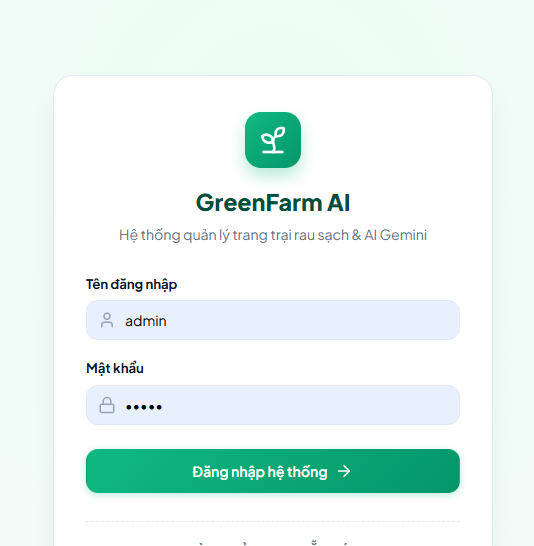

*Hình 7.1. Demo — Đăng nhập và phân quyền*

## 7.2. Lô trồng

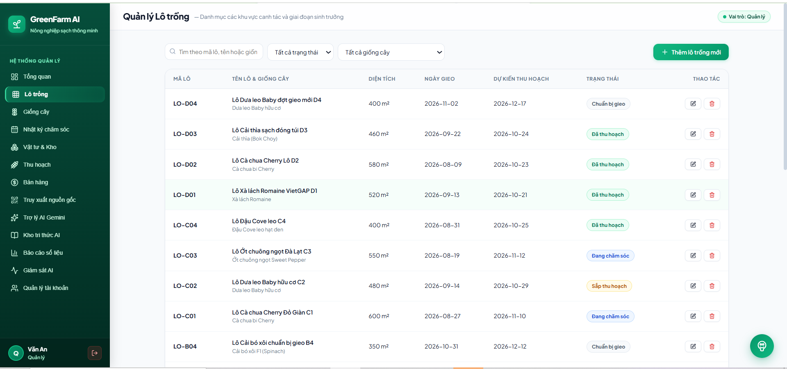

*Hình 7.2. Demo — Quản lý lô trồng*

## 7.3. Nhật ký chăm sóc

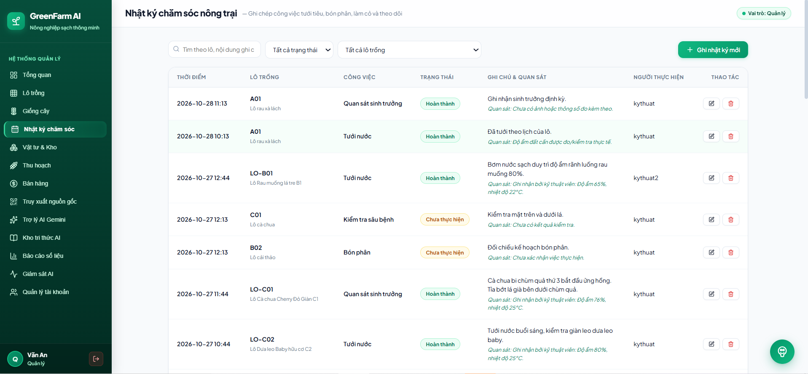

*Hình 7.3. Demo — Nhật ký chăm sóc*

## 7.4. Thu hoạch

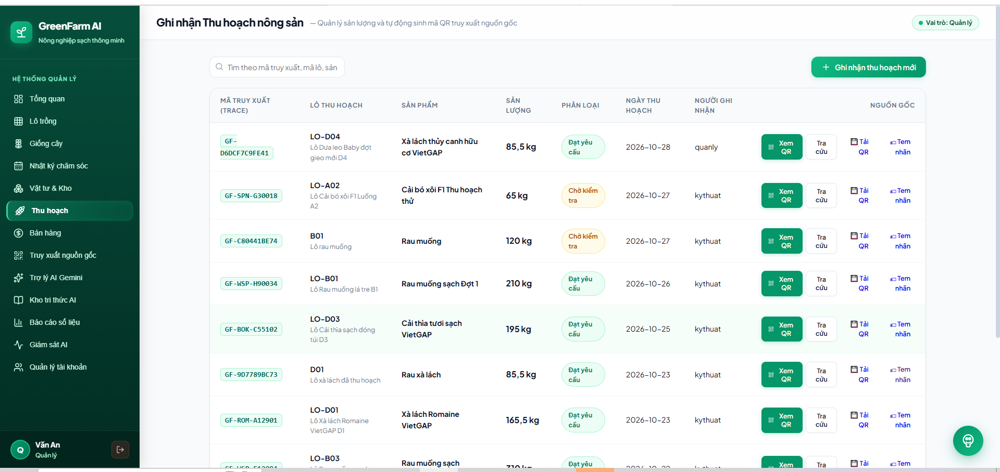

*Hình 7.4. Demo — Thu hoạch & mã QR*

## 7.5. Báo cáo số liệu

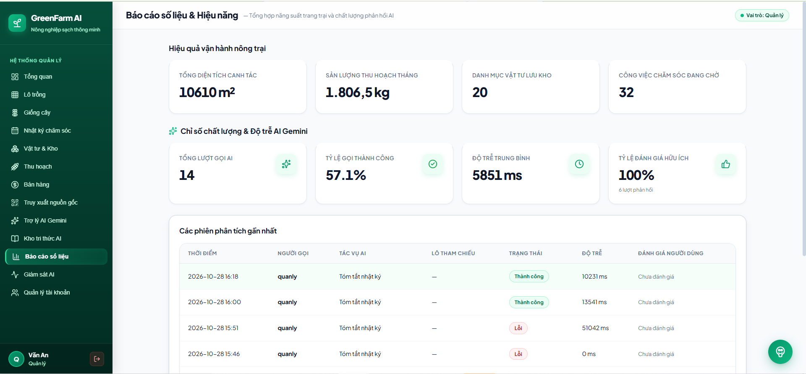

*Hình 7.5. Demo — Báo cáo số liệu*

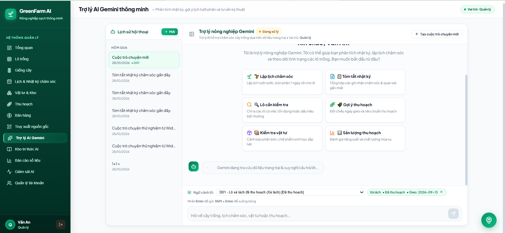

## 7.6. Chức năng AI

*Hình 7.6. Demo — Chức năng AI*

Chương 8. AI TRONG SDLC VÀ KẾT LUẬN

## 8.1. Vai trò AI trong SDLC

| Giai đoạn | Cách dùng AI | Kiểm chứng |
| --- | --- | --- |
| Phân tích | Phân tích yêu cầu, đề xuất use case | Loại bỏ chức năng vượt phạm vi |
| Thiết kế | Đề xuất ERD, API, prompt | Thêm Sale, Knowledge, Chatbot, AI Monitor |
| Lập trình | Sinh CRUD, debug, seed data | Sửa phân quyền, tách service, thêm RAG |
| Kiểm thử | Đề xuất test case, review code | Chạy thủ công 37 TC hộp đen |
| Tài liệu | Viết README, báo cáo | Hiệu đính, chèn ảnh demo thật |

Bài học: AI tăng tốc đáng kể (code lặp lại, tài liệu), nhưng có thể sinh lỗ hổng bảo mật, hallucination, đề xuất vượt phạm vi. Nguyên tắc Human-in-the-Loop luôn áp dụng: AI đề xuất, con người kiểm chứng và chịu trách nhiệm.

## 8.2. Kết quả đạt được và hạn chế

Kết quả đạt được

Hoàn thiện hệ thống đầy đủ: quản lý + bán hàng + truy xuất QR + thu hồi mã + 4 tác vụ AI + chatbot RAG + AI Monitor.

Có RAG kho tri thức giảm hallucination; cảnh báo tham khảo cố định; lưu AIInteraction minh chứng.

37 test case hộp đen + test tự động; minh chứng AI trong mọi giai đoạn SDLC.

Đủ sơ đồ chuẩn (Use Case, phân rã, Activity, Sequence×2, ERD, Component, Class, Deployment) + Data Dictionary + ADR.

Hạn chế

Chưa tích hợp cảm biến IoT (độ ẩm, nhiệt độ).

Kho tri thức mới ở mức cơ bản, cần chuyên gia bổ sung & kiểm chứng (is_verified).

Chatbot mới hỗ trợ tiếng Việt, độ trễ phụ thuộc Gemini.

## 8.3. Hướng phát triển

Tích hợp IoT cảm biến để dữ liệu chính xác hơn.

Mở rộng Agentic AI (tự động ghi nhật ký từ cảm biến, tự đặt lịch chăm sóc).

Ứng dụng mobile cho nhân viên ghi nhật ký tại vườn.

Tích hợp thanh toán online & theo dõi vận chuyển.

# TÀI LIỆU THAM KHẢO

Giáo trình "Ứng dụng Trí tuệ nhân tạo" — TS. Nguyễn Tuấn Anh, ĐH Thái Nguyên, 2026.

Django documentation: https://docs.djangoproject.com

Google Gemini API documentation: https://ai.google.dev/gemini-api/docs

PostgreSQL documentation: https://www.postgresql.org/docs

OWASP Top 10 for LLM Applications (2025).

PlantUML: https://plantuml.com — dùng vẽ sơ đồ UML.
