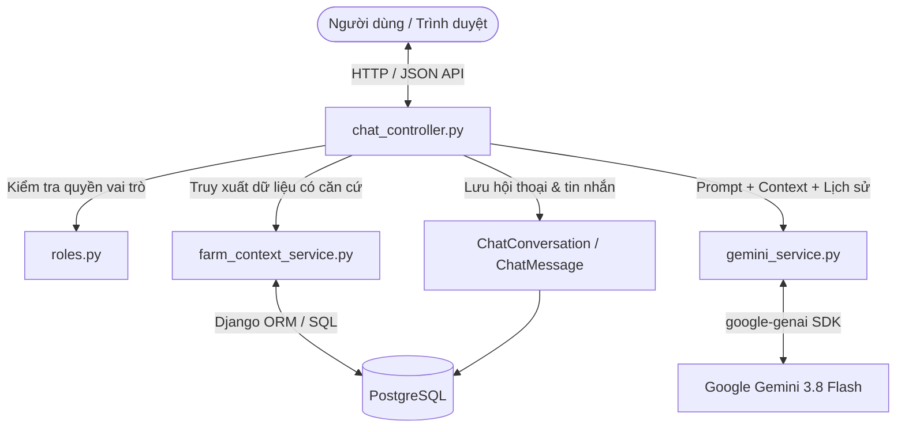

# GreenFarm AI — Hệ thống quản lý trang trại rau sạch & Trợ lý AI

Dự án đã được tái cấu trúc hoàn chỉnh và chuyên nghiệp theo mô hình **Tách biệt Backend API + Frontend SPA**, phân tầng rõ ràng (Layered / Clean Architecture) theo chuẩn thiết kế hiện đại.

---

## 1. Cấu trúc tổng thể dự án

```text
greenfarm-django/
├── backend/                       # BACKEND (Django REST API & Business Logic)
│   ├── config/                    # Cấu hình dự án (settings.py, urls.py, wsgi.py, database, CORS)
│   ├── farm/                      # Core Domain App
│   │   ├── controllers/           # Tầng Controller mỏng (Request handlers & Response logic)
│   │   │   ├── auth_controller.py
│   │   │   ├── dashboard_controller.py
│   │   │   ├── lot_controller.py
│   │   │   ├── care_controller.py
│   │   │   ├── material_controller.py
│   │   │   ├── harvest_controller.py
│   │   │   ├── sale_controller.py
│   │   │   ├── trace_controller.py
│   │   │   ├── ai_controller.py
│   │   │   ├── knowledge_controller.py
│   │   │   ├── report_controller.py
│   │   │   └── account_controller.py
│   │   ├── routes/                # Định nghĩa API routes (/api/...)
│   │   │   └── api_routes.py
│   │   ├── services/              # Tầng Business Logic & Reusable Services
│   │   │   ├── ai_service.py        (Gọi Gemini AI, tạo prompt, xử lý RAG)
│   │   │   ├── inventory_service.py (Trừ kho an toàn với Transaction lock)
│   │   │   ├── trace_service.py     (Tra cứu nguồn gốc theo mã lô / tem thu hoạch)
│   │   │   ├── dashboard_service.py (Tính toán KPI, cảnh báo tồn kho, doanh thu)
│   │   │   └── harvest_service.py   (Tạo phiếu thu hoạch, tự động chuyển trạng thái lô)
│   │   ├── models/ (models.py)    # ORM Database Models (CropLot, CareLog, Material, ...)
│   │   ├── validators/            # Request Payload Validation & Serializers
│   │   ├── middlewares/           # Custom Middlewares (Roles, API Error Handling)
│   │   ├── utils/                 # Utilities (Helpers, Role checks, Formatters)
│   │   ├── management/commands/   # Seed dữ liệu demo (seed_demo)
│   │   ├── migrations/            # Database migrations
│   │   └── prompts/               # System & Task Prompts cho Gemini AI
│   ├── manage.py
│   ├── requirements.txt
│   ├── .env.example
│   └── Dockerfile
│
├── frontend/                      # FRONTEND (React + Vite + Design System)
│   ├── public/                    # Static public assets (favicon.svg, robots.txt)
│   ├── src/
│   │   ├── assets/                # Hình ảnh, icon, font
│   │   ├── components/            # UI components (Navbar, Sidebar, ChatbotWidget, Modal, Badge, StatCard)
│   │   ├── pages/                 # Các trang chức năng
│   │   │   ├── LoginPage.jsx
│   │   │   ├── DashboardPage.jsx
│   │   │   ├── LotsPage.jsx
│   │   │   ├── VarietiesPage.jsx
│   │   │   ├── CareLogsPage.jsx
│   │   │   ├── MaterialsPage.jsx
│   │   │   ├── HarvestsPage.jsx
│   │   │   ├── SalesPage.jsx
│   │   │   ├── TracePage.jsx
│   │   │   ├── AIAssistantPage.jsx
│   │   │   ├── KnowledgePage.jsx
│   │   │   ├── ReportsPage.jsx
│   │   │   ├── AIMonitorPage.jsx
│   │   │   └── AccountsPage.jsx
│   │   ├── hooks/                 # Custom React hooks (useAuth, useFetch)
│   │   ├── context/               # Global state (AuthContext)
│   │   ├── services/              # Giao tiếp HTTP với Backend API (authService, farmService, aiService)
│   │   ├── utils/                 # Formatters (tiền tệ VND, khối lượng kg, ngày tháng)
│   │   ├── styles/                # CSS Design System tông màu xanh lá nông trại, glassmorphism
│   │   ├── App.jsx                # Layout & Điều hướng màn hình
│   │   └── main.jsx               # Entry point
│   ├── package.json
│   ├── vite.config.js
│   └── Dockerfile
│
├── docker-compose.yml             # Orchestration: PostgreSQL + Backend API + Frontend SPA
└── README.md
```

---

## 2. Hướng dẫn chạy môi trường phát triển (Local không cần Docker)

Nếu máy tính của bạn **chưa cài đặt Docker Desktop** (như lỗi `The term 'docker' is not recognized`), bạn có thể chạy trực tiếp bằng Python và Node.js cực kỳ nhanh chóng:

### Bước 1: Khởi động Backend (Django API)
Mở cửa sổ Terminal thứ nhất:
```powershell
cd backend

# 1. Tạo và kích hoạt môi trường ảo Python
python -m venv .venv
.venv\Scripts\Activate.ps1

# 2. Cài đặt thư viện
pip install -r requirements.txt

# 3. Tạo file cấu hình môi trường
if (!(Test-Path .env)) { Copy-Item .env.example .env }

# 4. Migrate database và tạo dữ liệu mẫu
python manage.py migrate
python manage.py seed_demo

# 5. Khởi động server API
python manage.py runserver 8000
```
Backend API sẽ lắng nghe tại: `http://127.0.0.1:8000/api/`

---

### Bước 2: Khởi động Frontend (React / Vite)
Mở cửa sổ Terminal thứ hai:
```powershell
cd frontend

# 1. Cài đặt dependencies (chỉ cần chạy lần đầu)
npm install

# 2. Khởi chạy dev server
npm run dev
```
Giao diện người dùng sẽ chạy tại: **`http://localhost:5173`**

---

## 3. Chạy bằng Docker Compose (Khi đã cài Docker Desktop)

Khi máy tính của bạn đã bật Docker Desktop:
```powershell
docker compose up --build
```
- Frontend: `http://localhost:3000`
- Backend API: `http://localhost:8000/api/`
- PostgreSQL: cổng `5433` trên máy host

---

## 4. Tài khoản demo trải nghiệm

| Vai trò | Tên đăng nhập | Mật khẩu | Quyền hạn |
|---|---|---|---|
| **Quản lý** | `quanly` | `Demo12345!` | Toàn quyền quản trị, bán hàng, kho tri thức, tài khoản, giám sát AI |
| **Kỹ thuật viên** | `kythuat` | `Demo12345!` | Quản lý lô, ghi nhận thu hoạch, tư vấn AI, xem kho tri thức |
| **Nhân viên** | `nhanvien` | `Demo12345!` | Ghi nhật ký chăm sóc, xuất dùng vật tư trong kho, tra cứu nguồn gốc |

---

## 5. Các điểm nổi bật trong cấu trúc mới

1. **Keep Controllers Thin**: Mọi controller trong `backend/farm/controllers/` chỉ xử lý việc nhận request, gọi service tương ứng và trả JSON chuẩn `api_response`.
2. **Business Logic in Services**: Các nghiệp vụ quan trọng (trừ kho an toàn với atomic transaction, tính toán KPI dashboard, gọi Gemini AI với cơ chế RAG, sinh mã QR truy xuất) được đóng gói độc lập trong `backend/farm/services/`.
3. **Frontend SPA Hiện đại**: Giao diện React responsive mượt mà, đầy đủ tính năng:
   - Dashboard với biểu đồ và chỉ số trực quan.
   - Thao tác Thêm/Sửa/Xóa lô trồng, giống cây, nhật ký chăm sóc qua Modal popup.
   - Xuất dùng vật tư với kiểm tra và trừ tồn kho thời gian thực.
   - Trang Tra cứu nguồn gốc nông sản công khai.
   - Tích hợp Gemini AI Chatbot với lịch sử hội thoại nhiều lượt, trích dẫn nguồn PostgreSQL RAG thực tế và đánh giá phản hồi.

---

## 6. Trợ lý Chatbot Nông nghiệp Gemini AI (Học phần AIA331)

### 6.1 Kiến trúc hệ thống Chatbot & Luồng RAG

Hệ thống chatbot hoạt động theo luồng truy xuất dữ liệu có căn cứ (Grounded RAG) khép kín:
1. **Tiếp nhận & Xác thực**: Kiểm tra phiên đăng nhập (Session & CSRF Token), vai trò người dùng (Manager, Technician, Staff).
2. **Kiểm tra quyền truy cập ngữ cảnh**: Xác thực người dùng có quyền đọc dữ liệu của lô trồng yêu cầu (chống truy cập trái phép chéo lô).
3. **Truy xuất ngữ cảnh thực tế từ PostgreSQL (farm_context_service.py)**:
   - Thông tin lô trồng, giống cây, ngày gieo, ngày dự kiến thu hoạch, tuổi cây.
   - 10 nhật ký chăm sóc gần nhất (tưới, bón phân, sâu bệnh, quan sát thực tế).
   - Tình trạng vật tư trong kho và cảnh báo tồn thấp.
   - Dữ liệu thu hoạch và chất lượng.
   - Tài liệu kỹ thuật từ kho tri thức AI (PostgreSQL RAG theo độ tương quan từ khóa & kiểm chứng).
4. **Xây dựng Prompt có cấu trúc**: Đưa dữ liệu thực tế vào System Instruction (`farm_assistant.txt`), kết hợp lịch sử 6 lượt hội thoại gần nhất và câu hỏi người dùng.
5. **Gọi Google Gemini API (gemini_service.py)**: Sử dụng SDK chính thức `google-genai` với model `gemini-3.8-flash` (hoặc cấu hình qua biến môi trường `GEMINI_MODEL`).
6. **Lưu trữ & Phản hồi**:
   - Lưu tin nhắn người dùng và phản hồi AI (`ChatMessage`).
   - Lưu nguồn tham chiếu thực tế (`references_data`).
   - Ghi nhật ký giám sát (`AIInteraction`) cho trang Giám sát AI.
   - Trả JSON chuẩn về giao diện React SPA hiển thị tin nhắn, hiệu ứng Markdown, nút sao chép và accordion dữ liệu tham chiếu.



---

### 6.2 Mô hình dữ liệu hội thoại (ERD)

- **`ChatConversation`**:
  - `id`: Khóa chính
  - `user`: Khóa ngoại `User` (on_delete=CASCADE, phân tách hội thoại theo tài khoản)
  - `title`: Tiêu đề hội thoại (tự động đặt tên theo câu hỏi đầu tiên)
  - `crop_lot`: Khóa ngoại tùy chọn tới `CropLot` (ngữ cảnh lô trồng cụ thể)
  - `is_archived`: Trạng thái lưu trữ
  - `created_at`, `updated_at`: Dấu mốc thời gian (có index hỗ trợ sắp xếp)
- **`ChatMessage`**:
  - `id`: Khóa chính
  - `conversation`: Khóa ngoại `ChatConversation` (on_delete=CASCADE)
  - `role`: `user` (Người dùng) hoặc `assistant` (Trợ lý AI)
  - `content`: Nội dung tin nhắn dạng văn bản
  - `status`: `done` hoặc `error`
  - `model_name`: Tên model LLM thực hiện (ví dụ `gemini-3.8-flash`)
  - `latency_ms`: Độ trễ phản hồi tính bằng mili-giây
  - `references_data`: JSONField chứa dữ liệu hệ thống thực tế đã dùng làm căn cứ
  - `created_at`: Thời điểm gửi tin nhắn
- **`ChatFeedback`**:
  - `message`: Khóa OneToOne tới `ChatMessage` (assistant)
  - `user`: Khóa ngoại tới `User` thực hiện đánh giá
  - `rating`: `1` (Hữu ích) hoặc `-1` (Chưa hữu ích)
  - `comment`: Góp ý chi tiết

---

### 6.3 Phân quyền ba vai trò

| Chức năng | Quản lý (Manager) | Kỹ thuật viên (Technician) | Nhân viên (Staff) |
|---|:---:|:---:|:---:|
| Trò chuyện tự do với AI | Toàn quyền | Toàn quyền | Giới hạn theo lô được phép |
| Ngữ cảnh toàn bộ trang trại | Xem toàn bộ lô & kho | Xem toàn bộ lô & kho | Chỉ xem các lô đang canh tác |
| Hỏi về vật tư & kho | Được phép | Được phép | Xem vật tư được phép xuất |
| Xem trang Giám sát AI | Toàn quyền | Không có quyền | Không có quyền |
| Phân tách lịch sử chat | Chỉ xem chat của mình | Chỉ xem chat của mình | Chỉ xem chat của mình |

---

### 6.4 Nhật ký ba vòng thử nghiệm Prompt (Prompt Evaluation Log)

| Vòng | Mục tiêu cải tiến | Input kiểm thử | Output thực tế | Đánh giá & Thay đổi |
|---|---|---|---|---|
| **Vòng 1** (Khởi tạo cơ bản) | Kiểm tra khả năng nhận diện dữ liệu lô trồng và giống cây | "Lập lịch chăm sóc 7 ngày tới cho lô A01" | AI trả về lịch tưới chung chung, tự suy đoán độ ẩm 80% và liều lượng thuốc BVTV khi chưa có đo đạc thực tế. | **Nhận xét**: AI bị ảo giác (hallucination) về số liệu đo lường. **Thay đổi**: Thêm nguyên tắc số 2 và 3 trong system prompt cấm bịa kết quả đo và bắt buộc phân biệt dữ liệu đã ghi nhận với suy luận. |
| **Vòng 2** (Kiểm soát an toàn & giới hạn dữ liệu) | Kiểm tra phản ứng khi câu hỏi thiếu dữ liệu thực địa | "Cây rau muống bị vàng lá thì phun thuốc gì?" | AI đưa ra cảnh báo không khẳng định bệnh khi thiếu kiểm tra trực tiếp; đề xuất 3 việc cần làm (kiểm tra rễ, thoát nước, đối chiếu lịch bón phân) và yêu cầu kiểm chứng thực tế. | **Nhận xét**: Phản hồi đã an toàn hơn nhưng cấu trúc còn dài dòng. **Thay đổi**: Quy định định dạng đầu ra chuẩn Markdown: Tiêu đề rõ ràng, gạch đầu dòng hành động và lời nhắc an toàn cuối câu. |
| **Vòng 3** (Grounded RAG & Kho tri thức) | Kiểm tra trích xuất tài liệu từ PostgreSQL và đa lượt hội thoại | "Có tài liệu nào về kỹ thuật tưới xà lách không?" tiếp theo là "Áp dụng vào lô A01 thế nào?" | AI trích xuất chính xác tài liệu "Kỹ thuật tưới xà lách" trong kho tri thức PostgreSQL, đối chiếu với ngày gieo của lô A01 (18 ngày tuổi) và đưa ra khung giờ tưới sáng sớm. | **Nhận xét**: Tích hợp RAG hoạt động chính xác, dữ liệu tham chiếu được hiển thị rõ ràng qua accordion UI. |

---

### 6.5 Bộ kiểm thử tự động (Test Suite)

Dự án bao gồm 28 bài kiểm thử tự động (16 bài kiểm thử hệ thống gốc + 12 bài kiểm thử chuyên sâu cho Chatbot AI).

Chạy kiểm thử:
```bash
docker exec greenfarm_backend python manage.py test
```
Kết quả kiểm thử thực tế:
```text
Found 28 test(s).
Creating test database for alias 'default'...
............................
----------------------------------------------------------------------
Ran 28 tests in 4.663s

OK
Destroying test database for alias 'default'...
```

Danh mục 12 ca kiểm thử chatbot trong [tests_chat.py](file:///d:/ai/greenfarm-django/backend/farm/tests_chat.py):
1. `test_01_unauthenticated_rejected`: Chặn người chưa đăng nhập truy cập API hội thoại (HTTP 401).
2. `test_02_conversation_isolation`: Cô lập dữ liệu hội thoại giữa các tài khoản (chỉ xem hội thoại của mình).
3. `test_03_lot_permission_enforcement`: Chặn truy vấn các lô ngoài phạm vi quyền hạn (HTTP 403).
4. `test_04_create_conversation_success`: Tạo cuộc trò chuyện mới thành công với đầy đủ thuộc tính.
5. `test_05_send_message_persists_records`: Lưu trữ chính xác tin nhắn người dùng, phản hồi AI và tự động đổi tên hội thoại.
6. `test_06_gemini_error_handling`: Xử lý lỗi timeout/mất kết nối Gemini an toàn, không làm sập server.
7. `test_07_missing_api_key_reported`: Thông báo rõ ràng khi chưa có API key mà không giả mạo kết quả AI.
8. `test_08_no_relevant_data_honesty`: Không bịa đặt tài liệu khi câu hỏi nằm ngoài phạm vi tri thức hiện có.
9. `test_09_message_feedback_rating`: Ghi nhận và cập nhật đánh giá phản hồi (Hữu ích / Chưa hữu ích).
10. `test_10_role_forgery_prevention`: Chống giả mạo vai trò quản trị qua request payload.
11. `test_11_delete_conversation_ownership_and_cascade`: Xóa hội thoại đúng quyền và xóa tầng (cascade) tin nhắn liên quan.
12. `test_12_legacy_compatibility`: Bảo toàn hoạt động của các module giám sát AI và quản trị trang trại cũ.

---

## 7. Hệ thống Quét QR & Truy xuất nguồn gốc rau sạch

### 7.1 Kiến trúc & Công nghệ
- **Backend:** Python Django, thư viện Python `qrcode[pil]>=8.0`, Pillow để tạo ảnh mã QR PNG/SVG chất lượng cao và nhãn tem dán sticker.
- **Database:** PostgreSQL — mở rộng model `CropLot` và `Harvest` với cờ `is_active`, `revoked_at`, `revoked_by`, `revocation_reason`.
- **Mã truy xuất:** Sinh tự động bằng chuẩn mật mã an toàn `secrets.token_hex(6).upper()` (`GF-XXXXXXXXXXXX`), không sử dụng ID số tuần tự tăng dần.
- **Frontend Camera Scanner:** Thư viện `html5-qrcode` tích hợp trên cả giao diện Django Templates (MPA) và React Vite (SPA).
  - Hỗ trợ camera trước/sau trên điện thoại di động và webcam máy tính.
  - Yêu cầu kết nối an toàn (HTTPS hoặc localhost) theo tiêu chuẩn bảo mật WebRTC / MediaDevices của trình duyệt.
  - Khử trùng đầu vào (Sanitization) loại bỏ thẻ HTML, kịch bản độc hại (`javascript:`), và ký tự lạ trước khi chuyển hướng.
  - Hai phương thức tra cứu song song: **Phương thức A (Camera QR)** và **Phương thức B (Nhập mã thủ công)**.

### 7.2 Tem nhãn in nhiệt (Sticker Label)
- Hỗ trợ xem trực tiếp, tải ảnh PNG độ nét cao (box size 8, border 2) và trang in nhãn tem chuyên dụng (`/trace/<code-or-token>/label/`).
- Tối ưu hóa `@media print` cho máy in tem nhiệt kích thước tiêu chuẩn (50x30mm, 70x50mm) hoặc in trên khổ giấy A4 decal.
- Nhãn in hiển thị: Thương hiệu GreenFarm AI, Tên nông sản, Giống cây, Mã lô trồng, Ngày thu hoạch, Sản lượng, Phẩm cấp chất lượng và Mã QR truy xuất.

### 7.3 Phân quyền & Quản lý vòng đời mã truy xuất
- **Khách mua hàng / Người tiêu dùng:** Không cần đăng nhập, quét QR hoặc nhập mã công khai để xem hồ sơ nông sản, lịch sử gieo trồng, nhật ký chăm sóc và đợt thu hoạch.
- **Bảo vệ quyền riêng tư nội bộ:** Giao diện công khai tự động ẩn họ tên nhân viên, email, số điện thoại và các ghi chú tác nghiệp nội bộ nhạy cảm.
- **Quản lý (Manager):** Có quyền vô hiệu hóa mã tem khi phát hiện sự cố chất lượng (chuyển trạng thái sang "Mã không còn hiệu lực", trả về HTTP 410) hoặc cấp lại mã truy xuất mới.
- **Kỹ thuật viên / Nhân viên:** Ghi nhận thu hoạch và tra cứu thông tin theo quyền hạn, không được phép tự ý thu hồi mã mà không có quyền Quản lý.

### 7.4 Bộ kiểm thử tự động 12 kịch bản (tests_trace.py)
Chạy kiểm thử:
```bash
docker exec greenfarm_backend python manage.py test farm.tests_trace
```
Kết quả kiểm thử thực tế:
```text
Found 12 test(s).
Creating test database for alias 'default'...
............
----------------------------------------------------------------------
Ran 12 tests in 1.658s

OK
Destroying test database for alias 'default'...
```
Danh mục 12 kịch bản đã được xác minh thành công:
1. `test_01_qr_code_generation`: Tạo ảnh QR PNG và Data URI thành công, kiểm chứng bằng thư viện PIL.
2. `test_02_qr_url_canonical`: QR mã hóa đúng định dạng URL chuẩn `https://<ten-mien-he-thong>/trace/<ma-truy-xuat>/`.
3. `test_03_manual_lookup_success`: Tra cứu thủ công bằng mã lô hoặc mã truy xuất thu hoạch trả về đầy đủ dữ liệu.
4. `test_04_code_not_found`: Mã không tồn tại hiển thị thông báo thân thiện và trả về HTTP 404 qua API.
5. `test_05_revoked_code`: Mã đã bị thu hồi trả về HTTP 410 (Gone), hiển thị cảnh báo đỏ "Mã không còn hiệu lực" kèm lý do và thời điểm.
6. `test_06_lot_without_harvests`: Lô mới gieo chưa thu hoạch vẫn hiển thị thông tin giống và chăm sóc mà không bị lỗi.
7. `test_07_no_internal_info_leaked`: Tuyệt đối không làm lộ email, số điện thoại, tên nhân viên và ghi chú nội bộ ra trang công khai.
8. `test_08_permission_enforcement`: Chặn khách vãng lai và nhân viên thường thực hiện vô hiệu hóa/cấp lại mã (HTTP 401/403).
9. `test_09_camera_unavailable_manual_fallback`: Máy không có camera hoặc từ chối quyền vẫn tra cứu được qua phương thức thủ công.
10. `test_10_malicious_qr_sanitization`: Mã QR giả mạo chứa thẻ script hoặc ký tự SQL Injection được khử trùng an toàn.
11. `test_11_desktop_and_mobile_views`: Giao diện tương thích hoàn hảo trên cả trình duyệt Desktop và Mobile, hỗ trợ in tem nhãn.
12. `test_12_legacy_compatibility`: Tương thích ngược với các mã lô và phiếu thu hoạch cũ của hệ thống.

