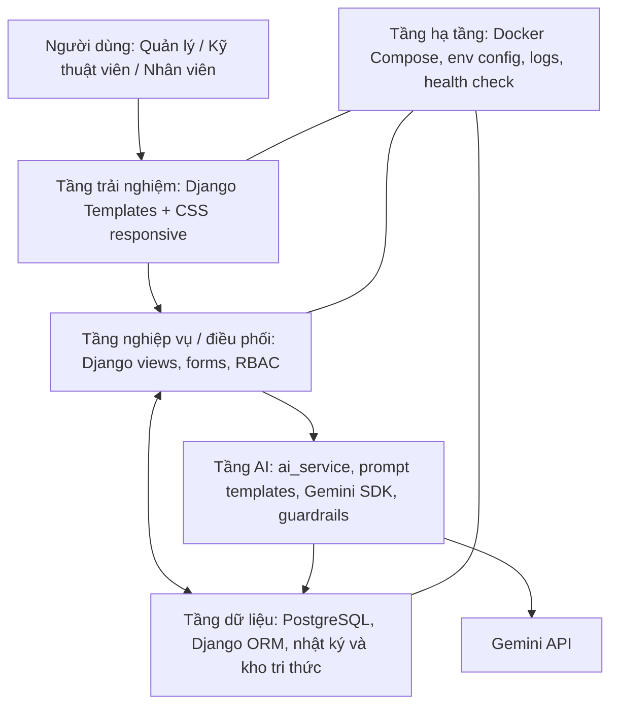

# Kiến trúc GreenFarm AI

## Sơ đồ 5 tầng (tham chiếu Chương 6)

## Luồng khi người dùng hỏi AI

1. Session xác thực người dùng; decorator kiểm tra vai trò tại backend.
2. Server kiểm tra tác vụ mà vai trò được phép dùng và xác nhận mã lô thuộc dữ liệu hệ thống.
3. `ai_service.py` lấy lô, nhật ký và phiếu vật tư liên quan; truy xuất tối đa 4 tài liệu phù hợp từ `KnowledgeArticle`.
4. Ghép prompt với năm phần: Instructions, Context, Input Data/Constraints, Examples, Output Format. Prompt system và prompt tác vụ nằm trong `farm/prompts/`.
5. Gọi Gemini bằng `google-genai` SDK trên server; API key không gửi đến HTML/JavaScript.
6. Kết quả rỗng/lỗi/key thiếu được xử lý có thông báo. Không tạo thay đổi tự động vào lô hoặc lịch.
7. Ghi nhật ký: user, task, lot, model, prompt version, sources, latency, trạng thái lỗi và feedback.

## Quyết định và giới hạn

- **Direct API call**: phù hợp với 3 tác vụ hẹp trong đề bài; chưa dùng agent tự hành vì sẽ làm giảm khả năng kiểm soát và tăng chi phí/rủi ro.
- **RAG baseline**: retrieval tìm từ khóa ở PostgreSQL để phù hợp quy mô MVP. Chưa phải semantic/vector search. Mở rộng tiếp theo là chunk tài liệu, Gemini embedding, PostgreSQL `pgvector`, retrieval top-k và test retrieval.
- **Human-in-the-loop**: kết quả AI là bản nháp, không tự động lưu thành lịch chăm sóc hoặc chấp nhận chất lượng thu hoạch.
- **Security**: quyền kiểm tra ở view; form validation; CSRF; Django password hashing; API key ở `.env`; production cần HTTPS, secrets management, backup và audit review.
