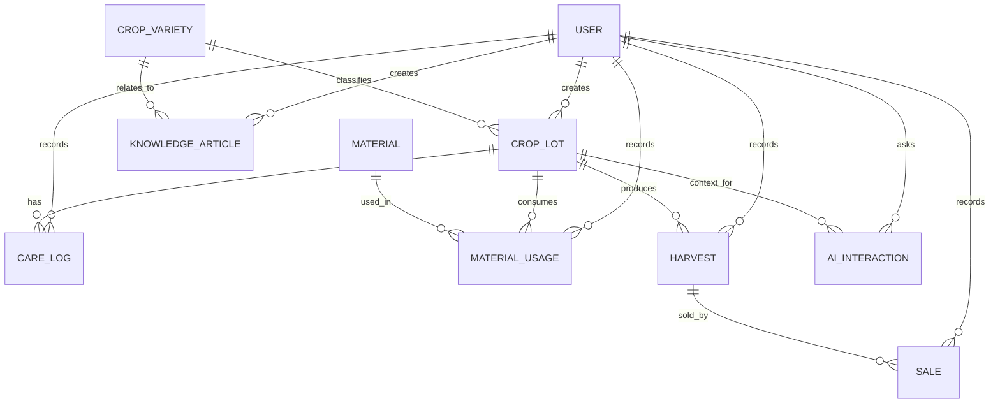

# ERD GreenFarm AI

## Ràng buộc chính

- `CropVariety.name`, `CropLot.code`, `Material.name` và `Harvest.trace_code` duy nhất.
- Diện tích, tồn kho, số lượng sử dụng/thu hoạch/bán và giá không âm; lượng sử dụng/bán phải dương.
- Không xóa giống đã được lô sử dụng; không xóa lô có phiếu thu hoạch để giữ truy xuất.
- Ghi phiếu vật tư trong transaction, khóa bản ghi tồn kho và trừ số lượng; kiểm tra lại tồn kho ở server để tránh oversell.
- Không xóa cứng dữ liệu tài khoản/AI logs cần kiểm toán trong production; MVP chỉ hỗ trợ khóa tài khoản và feedback.
